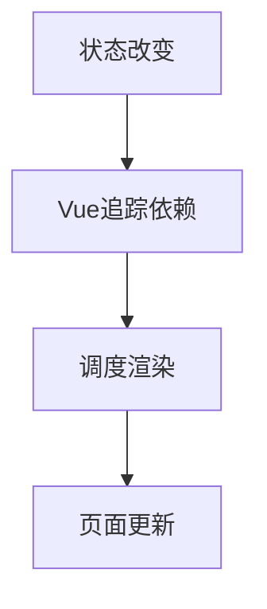

# 创建应用与响应式入门

> **当前主线**：用户指定的 Vue3＋TS 71 集课程；本篇为主题对照与自主讲解，旧 Vue2 演示保留为迁移参考。
> 示例版本：Vue 3.5.13；版本固定用于复现，不表示最新版本。

---

<span style="background-color:rgb(255, 249, 227)">一：学习目标与使用场景</span>

理解 Vue 为什么能在数据变化后自动更新页面，并分别运行 Vue 2 与 Vue 3 的最小应用。

---

<span style="background-color:rgb(255, 249, 227)">二：先把原理讲清楚</span>

原生 JavaScript 通常需要先找到 DOM，再读取和修改文本。Vue 把开发重心移到“页面有哪些状态、页面如何描述这些状态”。模板中的 count 是数据的展示位置，按钮事件只修改 count，Vue 再把变化反映到页面。

应用不是整个浏览器，也不是 Vue 库本身。createApp 创建一个应用实例；mount 把这个应用管理的内容连接到指定元素。页面可以有多个独立应用，但每个应用只负责自己的挂载范围。挂载目标必须已经存在，因此脚本放在挂载元素后面，或使用 defer。

Vue 3 的 setup 是组件创建时组织逻辑的入口。ref(0) 创建一个有 value 属性的响应式容器；脚本中读写 count.value，模板里会自动解包，所以写 count。先把“脚本需要 .value、模板一般不需要”记牢，再学复杂对象和组件通信。

数据修改是同步的，DOM 更新通常被 Vue 排队合并。连续点击会正确累计，但在修改后立刻读取 DOM，未必已经反映最新文本。需要等待 DOM 更新时使用 nextTick，详见生命周期专题。

---

<span style="background-color:rgb(255, 249, 227)">三：运行方式</span>

直接打开同目录下的 [配套演示](示例/01-创建应用与响应式入门.html)。运行库放在示例/vendor，已本地保存，普通示例不需要联网。Obsidian 的代码块用于阅读，不会自动执行 HTML。也可以把下面整段内容保存到示例目录中的新 HTML 文件；改变位置时需要相应调整运行库相对路径。

---

<span style="background-color:rgb(255, 249, 227)">四：完整代码演示</span>

```html
<!doctype html>
<html lang="zh-CN">
<head>
<meta charset="UTF-8">
<meta name="viewport" content="width=device-width, initial-scale=1">
<title>创建应用与响应式入门</title>
<style>
body{font-family:system-ui,sans-serif;line-height:1.7;margin:2rem auto;padding:0 1rem;max-width:58rem;color:#202124;background:#fff}button,input,select{font:inherit;padding:.4rem;margin:.3rem}button{cursor:pointer}label{display:inline-block;margin:.3rem}section{border:1px solid #aaa;padding:1rem;margin:1rem 0}li{margin:.4rem 0}pre{white-space:pre-wrap;overflow-wrap:anywhere}button:focus-visible,a:focus-visible,input:focus-visible,select:focus-visible{outline:3px solid #b45309}.active{background:#166534;color:#fff}nav{display:flex;gap:1rem;flex-wrap:wrap}
</style>
</head>
<body>
<div id="app">
<h1>计数器</h1><p id="count">次数：{{ count }}</p><button @click="count++">加一</button><button @click="count = 0">重置</button>
</div>
<script src="./vendor/vue-3.5.13.js"></script>
<script>
const { createApp, ref } = Vue;
createApp({
  setup() {
    const count = ref(0);
    return { count };
  }
}).mount('#app');
</script>
</body>
</html>
```

---

<span style="background-color:rgb(255, 249, 227)">五：按执行顺序解释</span>

1. 先在 HTML 中建立 id="app" 的挂载容器，按钮和文本都放在其中。
2. ref(0) 把普通数字放入可追踪的容器。只创建 let count = 0 不会获得相同的依赖追踪能力。
3. return { count } 暴露状态给模板。模板事件中 count++ 会经过 Vue 编译成对响应式状态的修改。
4. mount 执行后，模板中的双大括号消失，变成实际数字。

---

<span style="background-color:rgb(255, 249, 227)">六：预期结果与验证步骤</span>

初次打开显示“次数：0”。点击“加一”两次显示 2；点击“重置”恢复为 0。

操作时同时打开浏览器开发者工具：Elements 查看模板生成的节点，Console 查看是否有语法错误或 Vue 警告。若页面显示双大括号原文，优先检查运行库路径、脚本加载顺序和挂载目标。

---

<span style="background-color:rgb(255, 249, 227)">七：图解</span>



---

<span style="background-color:rgb(255, 249, 227)">八：注意事项与易错点</span>

- 不要同时让 Vue 和手写 DOM 操作控制同一块文本，容易出现状态和界面不一致。
- createApp 是 Vue 3 API；Vue 2 使用 new Vue。两种初始化代码不能混接。
- ref 声明在 setup 中意味着每个组件实例拥有自己的数据，声明在共享模块里则可能被多个组件共用。

---

<span style="background-color:rgb(255, 249, 227)">九：动手练习</span>

增加一个“减一”按钮，并限制次数不能低于 0。

<details>
<summary>参考答案与思路（先自己尝试）</summary>

```js
<button @click="count = Math.max(0, count - 1)">减一</button>
```

练习片段需要放入本篇已有的模板或 setup 对应位置，不是另一份独立文件。修改后重做上面的验证步骤，并检查空值、重复操作和恢复状态。

</details>

---

<span style="background-color:rgb(255, 249, 227)">十：复习问题</span>

1. 本篇中哪些数据是真正的源状态，哪些是推导结果或 DOM 表示？
2. 如果页面没有按预期更新，应该先检查运行环境、API 版本还是依赖关系？结合示例说明。
3. 能否不用背代码，用自己的话描述图中每一步的输入和输出？

### Vue 2 对照（使用 Vue 2 运行库）

```js
new Vue({
  el: '#app',
  data() { return { count: 0 }; }
});
```
Vue 2 模板仍能使用 {{ count }} 和 @click。差异在应用初始化和响应式实现；不要把 new Vue 写到 Vue 3 示例中。

---

<span style="background-color:rgb(255, 249, 227)">十一：相关笔记</span>

[[前端/VUE/00-Vue学习索引|开始学习]] · [[前端/VUE/02-插值表达式与属性绑定|下一篇：插值表达式与属性绑定]] · [[前端/VUE/00-Vue学习索引]]

---

<span style="background-color:rgb(255, 249, 227)">十二：官方参考与来源边界</span>

- [Vue 3 中文指南](https://cn.vuejs.org/guide/introduction.html)
- [Vue 2 中文指南](https://v2.cn.vuejs.org/v2/guide/)
- [Vue 2 维护结束说明](https://v2.vuejs.org/eol/)

原有示例和参考继续保留；当前课程目录已另行核验。没有取得字幕，不将自主讲解声称为视频逐字内容。

---

<span style="background-color:rgb(255, 249, 227)">专题深化：创建应用与状态连接</span>

**先分开三件事**：`createApp` 建应用实例，`mount` 把某个根组件接到容器，`ref/reactive` 让状态读写能参与依赖追踪。普通变量改变不会自动要求 Vue 更新界面。一个页面可以有多个应用，但它们的组件注册和依赖注入范围彼此独立。

**执行链**：组件 setup 建立状态 → 渲染时读取状态收集依赖 → 事件处理器修改状态 → Vue 调度更新 → DOM 提交。不要把“Vue 会更新”理解成每次赋值后 DOM 已立即改变，读更新后的元素应等 `nextTick`。

**C++17 对照**：可借用“对象持有状态”的直觉，不能把响应式代理理解成一个普通引用或智能指针；依赖收集与调度是框架额外实现的机制。

- [指定课程 P3—P5、P11—P14](https://www.bilibili.com/video/BV1Za4y1r7KE/?p=3)
- [[前端/VUE/00-课程目录与来源说明|已核验的完整分集目录与来源边界]]
- [Vue 官方指南](https://vuejs.org/guide/introduction.html)
- [Vue 与 TypeScript](https://vuejs.org/guide/typescript/composition-api.html)
