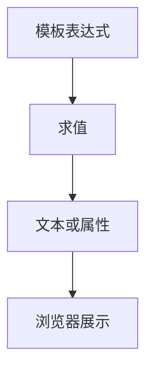

# 插值表达式与属性绑定

> **当前主线**：用户指定的 Vue3＋TS 71 集课程；本篇为主题对照与自主讲解，旧 Vue2 演示保留为迁移参考。
> 示例版本：Vue 3.5.13；版本固定用于复现，不表示最新版本。

---

<span style="background-color:rgb(255, 249, 227)">一：学习目标与使用场景</span>

区分文本插值与 HTML 属性绑定，理解 v-bind、缩写冒号和 v-html 的安全边界。

---

<span style="background-color:rgb(255, 249, 227)">二：先把原理讲清楚</span>

双大括号用于元素文本位置，例如 {{ name }}。它会把值作为文本展示，即使字符串里有 HTML 标签，也不会把标签当成新元素执行。这是展示用户输入时安全而常用的默认方式。

属性位置使用 v-bind。例如图片 src、链接 href、按钮 disabled 都是元素属性，不能写 src="{{ url }}"。v-bind:href 可以缩写成 :href，冒号表示右侧内容要当 JavaScript 表达式求值，而不是固定文字。

模板表达式可以访问已经暴露的状态、进行运算和调用函数，但不能在插值里写 if 语句或声明变量。复杂转换应移动到 computed 或函数中。表达式过长会同时增加调试和维护难度。

v-html 会把字符串作为 HTML 插入，因此它和文本插值具有完全不同的安全边界。不要把评论、昵称、接口返回的不可信 HTML 直接交给 v-html。富文本需求必须有经过审查的净化方案；普通文本始终优先插值。

---

<span style="background-color:rgb(255, 249, 227)">三：运行方式</span>

直接打开同目录下的 [配套演示](示例/02-插值表达式与属性绑定.html)。运行库放在示例/vendor，已本地保存，普通示例不需要联网。Obsidian 的代码块用于阅读，不会自动执行 HTML。也可以把下面整段内容保存到示例目录中的新 HTML 文件；改变位置时需要相应调整运行库相对路径。

---

<span style="background-color:rgb(255, 249, 227)">四：完整代码演示</span>

```html
<!doctype html>
<html lang="zh-CN">
<head>
<meta charset="UTF-8">
<meta name="viewport" content="width=device-width, initial-scale=1">
<title>插值表达式与属性绑定</title>
<style>
body{font-family:system-ui,sans-serif;line-height:1.7;margin:2rem auto;padding:0 1rem;max-width:58rem;color:#202124;background:#fff}button,input,select{font:inherit;padding:.4rem;margin:.3rem}button{cursor:pointer}label{display:inline-block;margin:.3rem}section{border:1px solid #aaa;padding:1rem;margin:1rem 0}li{margin:.4rem 0}pre{white-space:pre-wrap;overflow-wrap:anywhere}button:focus-visible,a:focus-visible,input:focus-visible,select:focus-visible{outline:3px solid #b45309}.active{background:#166534;color:#fff}nav{display:flex;gap:1rem;flex-wrap:wrap}
</style>
</head>
<body>
<div id="app">
<h1>{{ title.toUpperCase() }}</h1><label>标题 <input v-model="title"></label><p>字符数：{{ title.length }}</p><a :href="url">Vue 官方指南</a><p><button :disabled="title.trim() === ''">提交</button></p><p>{{ raw }}</p>
</div>
<script src="./vendor/vue-3.5.13.js"></script>
<script>
const { createApp, ref } = Vue;
createApp({ setup() {
  const title = ref('hello vue');
  const url = 'https://cn.vuejs.org/guide/';
  const raw = '<strong>这里仍然是纯文本</strong>';
  return { title, url, raw };
}}).mount('#app');
</script>
</body>
</html>
```

---

<span style="background-color:rgb(255, 249, 227)">五：按执行顺序解释</span>

1. title.toUpperCase() 只改变展示结果，没有覆盖 title 原始内容。
2. v-model 把输入框和 title 连接；输入后标题和字符数都会更新。
3. :href="url" 读取变量；href="url" 则会把 url 当成字面地址。
4. :disabled 的结果为布尔值。trim 后为空就禁用按钮，属性绑定不是字符串拼接。

---

<span style="background-color:rgb(255, 249, 227)">六：预期结果与验证步骤</span>

输入框初始是 hello vue，标题显示 HELLO VUE。清空或只输入空格时按钮禁用。最下方的 strong 标签作为文字显示。

操作时同时打开浏览器开发者工具：Elements 查看模板生成的节点，Console 查看是否有语法错误或 Vue 警告。若页面显示双大括号原文，优先检查运行库路径、脚本加载顺序和挂载目标。

---

<span style="background-color:rgb(255, 249, 227)">七：图解</span>



---

<span style="background-color:rgb(255, 249, 227)">八：注意事项与易错点</span>

- 避免给 :disabled 绑定字符串 "false"；非空字符串仍然是真值，应该绑定 false 布尔值。
- 链接若来自不可信输入，需要校验协议；文本转义不等于任意 URL 都安全。
- 模板内不要执行会改变状态的表达式；渲染应尽量保持纯计算。

---

<span style="background-color:rgb(255, 249, 227)">九：动手练习</span>

加入一个复选框，勾选时把链接的 target 设置为 _blank，否则为 _self。

<details>
<summary>参考答案与思路（先自己尝试）</summary>

```js
const openNew = ref(false); // 同时从 setup 返回 openNew
// 模板：<input type="checkbox" v-model="openNew">
// 链接：<a :href="url" :target="openNew ? '_blank' : '_self'" rel="noopener noreferrer">指南</a>
```

练习片段需要放入本篇已有的模板或 setup 对应位置，不是另一份独立文件。修改后重做上面的验证步骤，并检查空值、重复操作和恢复状态。

</details>

---

<span style="background-color:rgb(255, 249, 227)">十：复习问题</span>

1. 本篇中哪些数据是真正的源状态，哪些是推导结果或 DOM 表示？
2. 如果页面没有按预期更新，应该先检查运行环境、API 版本还是依赖关系？结合示例说明。
3. 能否不用背代码，用自己的话描述图中每一步的输入和输出？


---

<span style="background-color:rgb(255, 249, 227)">十一：相关笔记</span>

[[前端/VUE/01-创建应用与响应式入门|上一篇：创建应用与响应式入门]] · [[前端/VUE/03-事件绑定与修饰符|下一篇：事件绑定与修饰符]] · [[前端/VUE/00-Vue学习索引]]

---

<span style="background-color:rgb(255, 249, 227)">十二：官方参考与来源边界</span>

- [Vue 3 中文指南](https://cn.vuejs.org/guide/introduction.html)
- [Vue 2 中文指南](https://v2.cn.vuejs.org/v2/guide/)
- [Vue 2 维护结束说明](https://v2.vuejs.org/eol/)

原有示例和参考继续保留；当前课程目录已另行核验。没有取得字幕，不将自主讲解声称为视频逐字内容。

---

<span style="background-color:rgb(255, 249, 227)">专题深化：文本、属性与信任边界</span>

**模板不是字符串替换器**：插值在渲染上下文中求值，通常按文本转义输出；`v-bind` 把表达式的结果交给属性或 DOM property 处理。`disabled="false"` 这个静态字符串与 `:disabled="false"` 的布尔值不是同一种输入。

**逐步排查**：表达式是否在组件作用域存在 → 结果值类型是什么 → 绑定目标需要字符串、布尔值还是对象 → DOM 实际得到了什么。动态链接也应限定允许的协议和来源，不把任意外部字符串当安全地址。

`v-html` 会插入 HTML，不能对不可信用户内容直接使用。插值转义并不意味着所有 DOM 注入路径都自动安全。

- [指定课程 P4—P5](https://www.bilibili.com/video/BV1Za4y1r7KE/?p=4)
- [[前端/VUE/00-课程目录与来源说明|已核验的完整分集目录与来源边界]]
- [Vue 官方指南](https://vuejs.org/guide/introduction.html)
- [Vue 与 TypeScript](https://vuejs.org/guide/typescript/composition-api.html)
