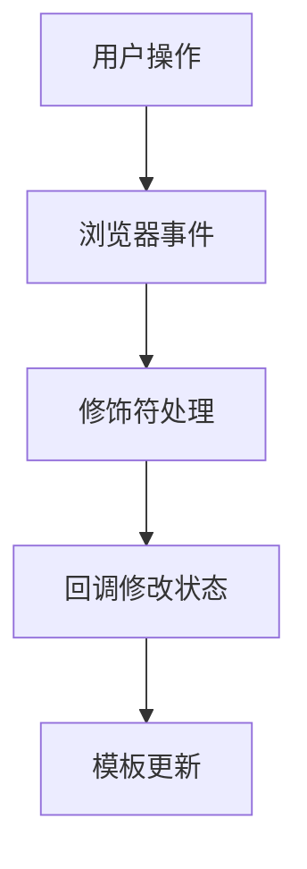

# 事件绑定与修饰符

> 课程范围：P117 至最后（用户指定）。未取得视频逐集标题与字幕，本篇为自主编写的知识体系笔记，不代表逐集内容已核验。
> 示例版本：Vue 3.5.13；版本固定用于复现，不表示最新版本。

## 学习目标与使用场景

使用 @click、事件参数与修饰符，理解默认行为和事件冒泡。

## 先把原理讲清楚

v-on:click 可以缩写为 @click。右侧既可以写少量内联表达式，也可以写函数名。需要复用、判断和访问事件对象时，函数比把所有逻辑堆进模板更清晰。

函数名写法 @click="increment" 会收到原生事件对象；写成 @click="increment(2, $event)" 时可以同时传业务参数和事件对象。$event 是模板提供的事件变量，不需要自己声明。

浏览器事件既有默认行为，也有传播过程。链接默认跳转、表单默认提交，这是默认行为；点击子元素时祖先也能监听到，这是冒泡。preventDefault 阻止默认行为，stopPropagation 阻止继续传播，两者不能互相替代。

Vue 提供 .prevent、.stop、.once、.enter 等修饰符减少重复代码。修饰符顺序可能改变含义，例如 .self 与 .prevent 的顺序影响默认行为的处理范围。不要为了“省事”给所有事件加 stop，否则父层委托逻辑会失效。

## 运行方式

直接打开同目录下的 [配套演示](示例/03-事件绑定与修饰符.html)。运行库放在示例/vendor，已本地保存，普通示例不需要联网。Obsidian 的代码块用于阅读，不会自动执行 HTML。也可以把下面整段内容保存到示例目录中的新 HTML 文件；改变位置时需要相应调整运行库相对路径。

## 完整代码演示

```html
<!doctype html>
<html lang="zh-CN">
<head>
<meta charset="UTF-8">
<meta name="viewport" content="width=device-width, initial-scale=1">
<title>事件绑定与修饰符</title>
<style>
body{font-family:system-ui,sans-serif;line-height:1.7;margin:2rem auto;padding:0 1rem;max-width:58rem;color:#202124;background:#fff}button,input,select{font:inherit;padding:.4rem;margin:.3rem}button{cursor:pointer}label{display:inline-block;margin:.3rem}section{border:1px solid #aaa;padding:1rem;margin:1rem 0}li{margin:.4rem 0}pre{white-space:pre-wrap;overflow-wrap:anywhere}button:focus-visible,a:focus-visible,input:focus-visible,select:focus-visible{outline:3px solid #b45309}.active{background:#166534;color:#fff}nav{display:flex;gap:1rem;flex-wrap:wrap}
</style>
</head>
<body>
<div id="app">
<h1>事件练习</h1><p>{{ count }}</p><button @click="increment(2, $event)">加二</button><form @submit.prevent="save"><label>名字 <input v-model="name" @keyup.enter="hint = '按下了 Enter'"></label><button>保存</button></form><p role="status">{{ hint }}</p>
</div>
<script src="./vendor/vue-3.5.13.js"></script>
<script>
const { createApp, ref } = Vue;
createApp({ setup() {
  const count = ref(0), name = ref(''), hint = ref('等待操作');
  function increment(step, event) {
    count.value += step;
    hint.value = '点击了 ' + event.currentTarget.textContent;
  }
  function save() { hint.value = '已保存：' + name.value; }
  return { count, name, hint, increment, save };
}}).mount('#app');
</script>
</body>
</html>
```

## 按执行顺序解释

1. 点击按钮时 increment 接收数字 2 和真实 MouseEvent。
2. currentTarget 是绑定监听器的元素；target 可能是按钮内部的图标或 span。
3. 表单绑定 submit.prevent，鼠标点击按钮和键盘提交都能进入 save，同时页面不刷新。
4. keyup.enter 在释放 Enter 时触发；按 Enter 还可能触发表单提交，所以最终提示可能被 save 覆盖。

## 预期结果与验证步骤

点击“加二”后计数从 0 变为 2；输入名字并保存后，提示显示“已保存：名字”，页面保持原位。

操作时同时打开浏览器开发者工具：Elements 查看模板生成的节点，Console 查看是否有语法错误或 Vue 警告。若页面显示双大括号原文，优先检查运行库路径、脚本加载顺序和挂载目标。

## 图解



## 注意事项与易错点

- 普通操作按钮在表单内部应写 type="button"，否则默认可能提交表单。
- 不要同时使用 passive 与 prevent，前者承诺不阻止默认行为。
- event.target 在复杂组件里可能不是预期元素，优先根据实际事件结构处理。

## 动手练习

给计数器增加一个只生效一次的加十按钮。

<details>
<summary>参考答案与思路（先自己尝试）</summary>

```js
<button type="button" @click.once="count += 10">只加一次十</button>
```

练习片段需要放入本篇已有的模板或 setup 对应位置，不是另一份独立文件。修改后重做上面的验证步骤，并检查空值、重复操作和恢复状态。

</details>

## 复习问题

1. 本篇中哪些数据是真正的源状态，哪些是推导结果或 DOM 表示？
2. 如果页面没有按预期更新，应该先检查运行环境、API 版本还是依赖关系？结合示例说明。
3. 能否不用背代码，用自己的话描述图中每一步的输入和输出？


## 相关笔记

[[前端/VUE/02-插值表达式与属性绑定|上一篇：插值表达式与属性绑定]] · [[前端/VUE/04-v-model与表单绑定|下一篇：v-model 与表单绑定]] · [[前端/VUE/00-Vue学习索引]]

## 官方参考与来源边界

- [Vue 3 中文指南](https://cn.vuejs.org/guide/introduction.html)
- [Vue 2 中文指南](https://v2.cn.vuejs.org/v2/guide/)
- [Vue 2 维护结束说明](https://v2.vuejs.org/eol/)

以上文档用于核对 API 和版本差异；课程链接与集数只来自用户指定范围，未据此编造每集标题或台词。
