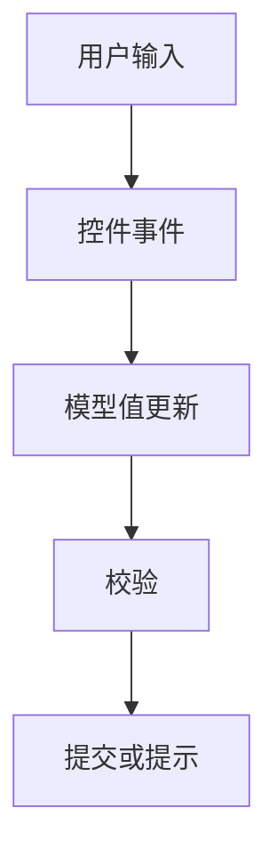

# v-model 与表单绑定

> 课程范围：P117 至最后（用户指定）。未取得视频逐集标题与字幕，本篇为自主编写的知识体系笔记，不代表逐集内容已核验。
> 示例版本：Vue 3.5.13；版本固定用于复现，不表示最新版本。

## 学习目标与使用场景

掌握文本、复选框、单选和选择框的数据绑定，以及 trim、number、lazy 的适用场景。

## 先把原理讲清楚

v-model 是表单值绑定和输入事件监听的语法糖，不是一个把任意元素都变成可编辑的万能指令。普通文本框通常对应 value 与 input；复选框对应 checked 与 change。不同原生控件的绑定规则由 Vue 处理。

单个复选框常绑定布尔值；一组具有 value 的复选框可以绑定数组。select 的选项值也可以通过 :value 绑定非字符串。先确定业务需要的是布尔、字符串、数值还是数组，再选择正确控件，避免后面大量强制转换。

.trim 会去掉输入两端的空白，.number 尝试数值转换，.lazy 改成在 change 后同步。注意清空 number 输入框时结果仍可能是空字符串，因此不能认为加了 number 就永远得到有限数字。提交前仍要检查类型、范围和格式。

Vue 在输入法组合输入期间通常会等待 composition 完成再同步状态，这是为了避免拼音输入时不断截断候选。即时搜索等需求应了解输入法行为，不要误把正常延迟当成响应式失效。

## 运行方式

直接打开同目录下的 [配套演示](示例/04-v-model与表单绑定.html)。运行库放在示例/vendor，已本地保存，普通示例不需要联网。Obsidian 的代码块用于阅读，不会自动执行 HTML。也可以把下面整段内容保存到示例目录中的新 HTML 文件；改变位置时需要相应调整运行库相对路径。

## 完整代码演示

```html
<!doctype html>
<html lang="zh-CN">
<head>
<meta charset="UTF-8">
<meta name="viewport" content="width=device-width, initial-scale=1">
<title>v-model 与表单绑定</title>
<style>
body{font-family:system-ui,sans-serif;line-height:1.7;margin:2rem auto;padding:0 1rem;max-width:58rem;color:#202124;background:#fff}button,input,select{font:inherit;padding:.4rem;margin:.3rem}button{cursor:pointer}label{display:inline-block;margin:.3rem}section{border:1px solid #aaa;padding:1rem;margin:1rem 0}li{margin:.4rem 0}pre{white-space:pre-wrap;overflow-wrap:anywhere}button:focus-visible,a:focus-visible,input:focus-visible,select:focus-visible{outline:3px solid #b45309}.active{background:#166534;color:#fff}nav{display:flex;gap:1rem;flex-wrap:wrap}
</style>
</head>
<body>
<div id="app">
<h1>报名表</h1><form @submit.prevent="submit"><label>姓名 <input v-model.trim="name" required></label><label>年龄 <input type="number" v-model.number="age" min="1" required></label><label><input type="checkbox" value="HTML" v-model="skills">HTML</label><label><input type="checkbox" value="Vue" v-model="skills">Vue</label><button>预览</button></form><pre>{{ preview }}</pre>
</div>
<script src="./vendor/vue-3.5.13.js"></script>
<script>
const { createApp, ref } = Vue;
createApp({ setup() {
  const name = ref(''), age = ref(18), skills = ref([]), preview = ref('');
  function submit() {
    if (!Number.isFinite(age.value) || age.value < 1) {
      preview.value = '请填写有效年龄'; return;
    }
    preview.value = JSON.stringify({name: name.value, age: age.value, skills: skills.value}, null, 2);
  }
  return { name, age, skills, preview, submit };
}}).mount('#app');
</script>
</body>
</html>
```

## 按执行顺序解释

1. name、age、skills 分别是字符串、数字、数组，模型形状由业务定义。
2. 两个复选框共享 skills，勾选时把各自 value 加入数组，取消时移除。
3. submit 先校验年龄，再序列化预览；JSON.stringify 的第三个参数 2 提供缩进。
4. required 和 min 由浏览器原生校验处理；真实后端收到数据后还必须再次校验。

## 预期结果与验证步骤

输入姓名和年龄，勾选 HTML 后预览包含 skills: ["HTML"]；同时勾选 Vue 后数组有两项。

操作时同时打开浏览器开发者工具：Elements 查看模板生成的节点，Console 查看是否有语法错误或 Vue 警告。若页面显示双大括号原文，优先检查运行库路径、脚本加载顺序和挂载目标。

## 图解



## 注意事项与易错点

- v-model 的初始值以 JavaScript 状态为准，不以静态 value 属性为准。
- 不要在复杂表单里同时手动设置 value 又用 v-model 控制同一输入框。
- 组件上的 v-model 与原生输入不同；Vue 2 和 Vue 3 默认 props/事件名称不同，见通信专题。

## 动手练习

增加“城市”选择框，并把选择结果加入预览 JSON。

<details>
<summary>参考答案与思路（先自己尝试）</summary>

```js
const city = ref('上海'); // 返回 city，并加入 submit 的对象
// <select v-model="city"><option>上海</option><option>北京</option></select>
```

练习片段需要放入本篇已有的模板或 setup 对应位置，不是另一份独立文件。修改后重做上面的验证步骤，并检查空值、重复操作和恢复状态。

</details>

## 复习问题

1. 本篇中哪些数据是真正的源状态，哪些是推导结果或 DOM 表示？
2. 如果页面没有按预期更新，应该先检查运行环境、API 版本还是依赖关系？结合示例说明。
3. 能否不用背代码，用自己的话描述图中每一步的输入和输出？


## 相关笔记

[[前端/VUE/03-事件绑定与修饰符|上一篇：事件绑定与修饰符]] · [[前端/VUE/05-条件渲染v-if与v-show|下一篇：条件渲染 v-if 与 v-show]] · [[前端/VUE/00-Vue学习索引]]

## 官方参考与来源边界

- [Vue 3 中文指南](https://cn.vuejs.org/guide/introduction.html)
- [Vue 2 中文指南](https://v2.cn.vuejs.org/v2/guide/)
- [Vue 2 维护结束说明](https://v2.vuejs.org/eol/)

以上文档用于核对 API 和版本差异；课程链接与集数只来自用户指定范围，未据此编造每集标题或台词。
