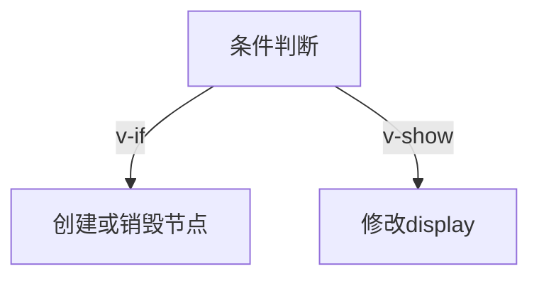

# 条件渲染 v-if 与 v-show

> 课程范围：P117 至最后（用户指定）。未取得视频逐集标题与字幕，本篇为自主编写的知识体系笔记，不代表逐集内容已核验。
> 示例版本：Vue 3.5.13；版本固定用于复现，不表示最新版本。

## 学习目标与使用场景

根据显示频率与组件生命周期选择条件渲染策略。

## 先把原理讲清楚

v-if 在条件为假时不创建对应 DOM 或组件，条件变真时才挂载。切换条件会触发销毁与重建，因此内部输入值、组件状态和副作用都可能重新开始。它适合权限区块、尚未加载的内容或很少切换的面板。

v-show 始终创建元素，只通过 display 控制可见性。频繁显示/隐藏时通常可以减少重建开销，但初次渲染依然发生。它不会把不存在的数据变成安全数据：若模板读取一个 null 的属性，单靠 v-show 隐藏不能避免表达式报错。

v-else-if 和 v-else 必须紧跟对应分支，形成完整条件链。需要一次控制多个节点但不想额外包装时，使用 template v-if；template 不会生成真实包装元素。v-show 不支持这种 template 分组方式。

当同一元素既有 v-if 又有 v-for 时，不同 Vue 版本的优先级存在差异，也会影响别名能否被访问。可维护的做法是先用 computed 筛选列表，或把条件放到外层 template，使条件与循环职责清楚。

## 运行方式

直接打开同目录下的 [配套演示](示例/05-条件渲染v-if与v-show.html)。运行库放在示例/vendor，已本地保存，普通示例不需要联网。Obsidian 的代码块用于阅读，不会自动执行 HTML。也可以把下面整段内容保存到示例目录中的新 HTML 文件；改变位置时需要相应调整运行库相对路径。

## 完整代码演示

```html
<!doctype html>
<html lang="zh-CN">
<head>
<meta charset="UTF-8">
<meta name="viewport" content="width=device-width, initial-scale=1">
<title>条件渲染 v-if 与 v-show</title>
<style>
body{font-family:system-ui,sans-serif;line-height:1.7;margin:2rem auto;padding:0 1rem;max-width:58rem;color:#202124;background:#fff}button,input,select{font:inherit;padding:.4rem;margin:.3rem}button{cursor:pointer}label{display:inline-block;margin:.3rem}section{border:1px solid #aaa;padding:1rem;margin:1rem 0}li{margin:.4rem 0}pre{white-space:pre-wrap;overflow-wrap:anywhere}button:focus-visible,a:focus-visible,input:focus-visible,select:focus-visible{outline:3px solid #b45309}.active{background:#166534;color:#fff}nav{display:flex;gap:1rem;flex-wrap:wrap}
</style>
</head>
<body>
<div id="app">
<h1>显示策略</h1><button @click="visible = !visible">切换</button><section v-if="visible"><h2>v-if 面板</h2><input placeholder="隐藏再显示会重建"></section><section v-show="visible"><h2>v-show 面板</h2><input placeholder="隐藏再显示仍保留"></section><p v-if="visible">当前显示</p><p v-else>当前隐藏</p>
</div>
<script src="./vendor/vue-3.5.13.js"></script>
<script>
const { createApp, ref } = Vue;
createApp({ setup() {
  const visible = ref(true);
  return { visible };
}}).mount('#app');
</script>
</body>
</html>
```

## 按执行顺序解释

1. visible 初始为 true，两个面板都被展示。
2. 两个 input 没有 v-model，文本保存在各自 DOM 节点上，用来观察节点是否被销毁。
3. 切换到 false 后，v-if 面板移除，v-show 面板仍存在但 display 为 none。
4. 再次显示时，v-if 输入值消失，v-show 输入值仍保留。若加了 v-model 并保留外部状态，两者都可恢复值。

## 预期结果与验证步骤

在两个输入框分别输入文字，再连续切换两次，能直接比较重建 DOM 和隐藏 DOM 的差别。

操作时同时打开浏览器开发者工具：Elements 查看模板生成的节点，Console 查看是否有语法错误或 Vue 警告。若页面显示双大括号原文，优先检查运行库路径、脚本加载顺序和挂载目标。

## 图解



## 注意事项与易错点

- 不要用 v-show 保护可能为 null 的深层属性访问。
- 不要把 CSS 隐藏当成安全控制；服务端仍须进行权限校验。
- v-if 的成本取决于子树大小，不要机械认为某个指令永远更快。

## 动手练习

加入加载中、加载失败、成功三种互斥状态，并用分支链显示。

<details>
<summary>参考答案与思路（先自己尝试）</summary>

```js
<p v-if="status === 'loading'">加载中</p>
<p v-else-if="status === 'error'">加载失败</p>
<section v-else>成功内容</section>
```

练习片段需要放入本篇已有的模板或 setup 对应位置，不是另一份独立文件。修改后重做上面的验证步骤，并检查空值、重复操作和恢复状态。

</details>

## 复习问题

1. 本篇中哪些数据是真正的源状态，哪些是推导结果或 DOM 表示？
2. 如果页面没有按预期更新，应该先检查运行环境、API 版本还是依赖关系？结合示例说明。
3. 能否不用背代码，用自己的话描述图中每一步的输入和输出？


## 相关笔记

[[前端/VUE/04-v-model与表单绑定|上一篇：v-model 与表单绑定]] · [[前端/VUE/06-列表渲染与稳定key|下一篇：列表渲染与稳定 key]] · [[前端/VUE/00-Vue学习索引]]

## 官方参考与来源边界

- [Vue 3 中文指南](https://cn.vuejs.org/guide/introduction.html)
- [Vue 2 中文指南](https://v2.cn.vuejs.org/v2/guide/)
- [Vue 2 维护结束说明](https://v2.vuejs.org/eol/)

以上文档用于核对 API 和版本差异；课程链接与集数只来自用户指定范围，未据此编造每集标题或台词。
