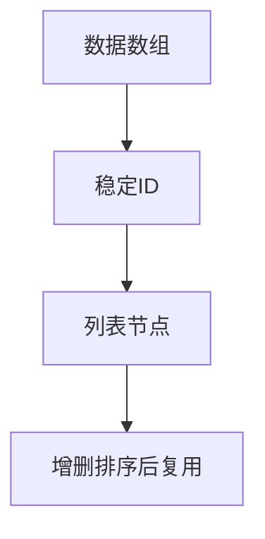

# 列表渲染与稳定 key

> **当前主线**：用户指定的 Vue3＋TS 71 集课程；本篇为主题对照与自主讲解，旧 Vue2 演示保留为迁移参考。
> 示例版本：Vue 3.5.13；版本固定用于复现，不表示最新版本。

---

<span style="background-color:rgb(255, 249, 227)">一：学习目标与使用场景</span>

用 v-for 展示数组，用业务 ID 稳定关联数据、组件与 DOM。

---

<span style="background-color:rgb(255, 249, 227)">二：先把原理讲清楚</span>

v-for 把数组中的每一项映射成界面，常用语法是 (item, index) in items。item 是当前数据，index 是当前位置。位置会随插入、删除和排序改变，因此它通常不适合作为有状态列表的身份标识。

key 是 Vue 更新列表时识别节点的线索。假设两行都有输入框，删除第一行后，第二行虽然变成第一个位置，但仍然应该保留自己的输入与组件状态。稳定且唯一的业务 ID 能让 Vue 跟踪“同一个项目”而不是“同一个位置”。

数组的 push、splice、filter 等可以驱动响应式更新。filter 不修改原数组，会返回一个新数组；使用 ref 包装数组时，把新数组赋回 items.value 即可。Vue 2 中下标写入和 length 修改有额外限制，见 Vue 2 专题。

筛选与排序最好放入 computed，模板只负责渲染。不要在 computed 中直接 sort 原数组，因为 sort 会就地修改源数据；可以先复制 [...items] 再排序，避免读操作偷偷改变其他视图。

---

<span style="background-color:rgb(255, 249, 227)">三：运行方式</span>

直接打开同目录下的 [配套演示](示例/06-列表渲染与稳定key.html)。运行库放在示例/vendor，已本地保存，普通示例不需要联网。Obsidian 的代码块用于阅读，不会自动执行 HTML。也可以把下面整段内容保存到示例目录中的新 HTML 文件；改变位置时需要相应调整运行库相对路径。

---

<span style="background-color:rgb(255, 249, 227)">四：完整代码演示</span>

```html
<!doctype html>
<html lang="zh-CN">
<head>
<meta charset="UTF-8">
<meta name="viewport" content="width=device-width, initial-scale=1">
<title>列表渲染与稳定 key</title>
<style>
body{font-family:system-ui,sans-serif;line-height:1.7;margin:2rem auto;padding:0 1rem;max-width:58rem;color:#202124;background:#fff}button,input,select{font:inherit;padding:.4rem;margin:.3rem}button{cursor:pointer}label{display:inline-block;margin:.3rem}section{border:1px solid #aaa;padding:1rem;margin:1rem 0}li{margin:.4rem 0}pre{white-space:pre-wrap;overflow-wrap:anywhere}button:focus-visible,a:focus-visible,input:focus-visible,select:focus-visible{outline:3px solid #b45309}.active{background:#166534;color:#fff}nav{display:flex;gap:1rem;flex-wrap:wrap}
</style>
</head>
<body>
<div id="app">
<h1>任务列表</h1><form @submit.prevent="add"><input v-model.trim="draft" aria-label="新任务"><button>添加</button></form><ul><li v-for="task in tasks" :key="task.id"><input type="checkbox" v-model="task.done">{{ task.title }}<button @click="remove(task.id)">删除</button></li></ul><p>共 {{ tasks.length }} 项</p>
</div>
<script src="./vendor/vue-3.5.13.js"></script>
<script>
const { createApp, ref } = Vue;
createApp({ setup() {
  const tasks = ref([{id: 1, title: '学习 key', done: false}]);
  const draft = ref(''); let nextId = 2;
  function add() {
    if (!draft.value) return;
    tasks.value.push({id: nextId++, title: draft.value, done: false});
    draft.value = '';
  }
  function remove(id) { tasks.value = tasks.value.filter(task => task.id !== id); }
  return {tasks, draft, add, remove};
}}).mount('#app');
</script>
</body>
</html>
```

---

<span style="background-color:rgb(255, 249, 227)">五：按执行顺序解释</span>

1. nextId 每次添加后递增，新增项目有自己的 ID。真实服务端数据应使用服务端的稳定 ID。
2. v-for 的 key 放在实际重复节点 li 上，不能把所有行都写成同一个 key。
3. 复选框绑定 task.done，直接反映对象中的完成状态。
4. remove 根据 ID 过滤，避免依赖可能变化的数组下标。

---

<span style="background-color:rgb(255, 249, 227)">六：预期结果与验证步骤</span>

添加两条任务，勾选其中一条，再删除其他任务，勾选状态仍与原任务对应。

操作时同时打开浏览器开发者工具：Elements 查看模板生成的节点，Console 查看是否有语法错误或 Vue 警告。若页面显示双大括号原文，优先检查运行库路径、脚本加载顺序和挂载目标。

---

<span style="background-color:rgb(255, 249, 227)">七：图解</span>



---

<span style="background-color:rgb(255, 249, 227)">八：注意事项与易错点</span>

- 不要用 Math.random() 或 Date.now() 在每次渲染时生成 key，身份会不断变化。
- 同一父节点下的 key 必须唯一。
- Vue 3 中 template v-for 的 key 放在 template 上，Vue 2 对 template key 的规则不同。

---

<span style="background-color:rgb(255, 249, 227)">九：动手练习</span>

增加一个“按标题排序”按钮，排序后保持复选状态。

<details>
<summary>参考答案与思路（先自己尝试）</summary>

```js
function sortByTitle() {
  tasks.value = [...tasks.value].sort((a, b) => a.title.localeCompare(b.title, 'zh-CN'));
}
```

练习片段需要放入本篇已有的模板或 setup 对应位置，不是另一份独立文件。修改后重做上面的验证步骤，并检查空值、重复操作和恢复状态。

</details>

---

<span style="background-color:rgb(255, 249, 227)">十：复习问题</span>

1. 本篇中哪些数据是真正的源状态，哪些是推导结果或 DOM 表示？
2. 如果页面没有按预期更新，应该先检查运行环境、API 版本还是依赖关系？结合示例说明。
3. 能否不用背代码，用自己的话描述图中每一步的输入和输出？


---

<span style="background-color:rgb(255, 249, 227)">十一：相关笔记</span>

[[前端/VUE/05-条件渲染v-if与v-show|上一篇：条件渲染 v-if 与 v-show]] · [[前端/VUE/07-computed计算属性|下一篇：computed 计算属性]] · [[前端/VUE/00-Vue学习索引]]

---

<span style="background-color:rgb(255, 249, 227)">十二：官方参考与来源边界</span>

- [Vue 3 中文指南](https://cn.vuejs.org/guide/introduction.html)
- [Vue 2 中文指南](https://v2.cn.vuejs.org/v2/guide/)
- [Vue 2 维护结束说明](https://v2.vuejs.org/eol/)

原有示例和参考继续保留；当前课程目录已另行核验。没有取得字幕，不将自主讲解声称为视频逐字内容。

---

<span style="background-color:rgb(255, 249, 227)">专题深化：key 标识身份而不是位置</span>

同一个组件类型下，稳定 key 帮助框架判断“这是原来的哪一项”。列表重排时，数组下标表示位置而不是业务身份；若用 index 作 key，某项输入状态可能跟着位置错配到另一条数据。

**对照步骤**：先给每条记录生成持久 id → 用 id 作为 key → 删除或排序只改变列表，不临时重造所有 id → 在界面输入后重排验证状态是否跟随正确项。随机数 key 每次渲染都变，反而迫使重建。

不要把 key 当普通 prop 自动读取；要传业务 id 仍应明确绑定。与 C++ 容器迭代器的直觉也不同，key 不是对象内存地址。

- [指定课程 P5](https://www.bilibili.com/video/BV1Za4y1r7KE/?p=5)
- [[前端/VUE/00-课程目录与来源说明|已核验的完整分集目录与来源边界]]
- [Vue 官方指南](https://vuejs.org/guide/introduction.html)
- [Vue 与 TypeScript](https://vuejs.org/guide/typescript/composition-api.html)
