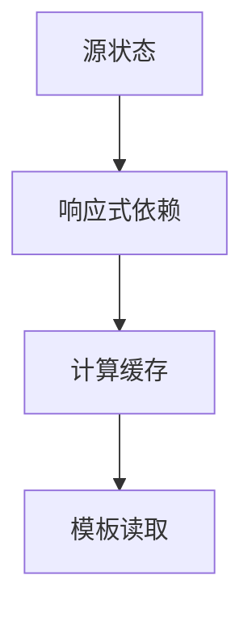

# computed 计算属性

> **当前主线**：用户指定的 Vue3＋TS 71 集课程；本篇为主题对照与自主讲解，旧 Vue2 演示保留为迁移参考。
> 示例版本：Vue 3.5.13；版本固定用于复现，不表示最新版本。

---

<span style="background-color:rgb(255, 249, 227)">一：学习目标与使用场景</span>

把派生数据写成计算属性，理解依赖缓存与 methods 的区别。

---

<span style="background-color:rgb(255, 249, 227)">二：先把原理讲清楚</span>

当一个值能由其他状态推导出来，例如购物车总价，就通常不需要再保存一份可手动修改的 total。保存两份来源相同的数据会产生同步问题：价格改了，total 忘记改，界面就互相矛盾。

computed 接收一个返回结果的 getter。getter 执行时读取的响应式状态会成为依赖；依赖没变，多次读取可以复用缓存。methods 则是在调用时重新执行，适合事件处理或需要传入参数的操作。

计算属性应该尽量是纯计算：不要发送网络请求、写入 localStorage 或修改源数组。纯 getter 更容易预测、测试和重用。默认 computed 是只读派生值；确实需要双向映射时才能提供 get/set，而不是为了规避只读报错随便添加 setter。

同样的思路适用于搜索结果、已完成数量、按钮是否可用。判断依据是“这个值能否由现有状态直接算出”；如果可以，优先 computed。如果是“数据变化之后要做一件外部事情”，才考虑 watch。

---

<span style="background-color:rgb(255, 249, 227)">三：运行方式</span>

直接打开同目录下的 [配套演示](示例/07-computed计算属性.html)。运行库放在示例/vendor，已本地保存，普通示例不需要联网。Obsidian 的代码块用于阅读，不会自动执行 HTML。也可以把下面整段内容保存到示例目录中的新 HTML 文件；改变位置时需要相应调整运行库相对路径。

---

<span style="background-color:rgb(255, 249, 227)">四：完整代码演示</span>

```html
<!doctype html>
<html lang="zh-CN">
<head>
<meta charset="UTF-8">
<meta name="viewport" content="width=device-width, initial-scale=1">
<title>computed 计算属性</title>
<style>
body{font-family:system-ui,sans-serif;line-height:1.7;margin:2rem auto;padding:0 1rem;max-width:58rem;color:#202124;background:#fff}button,input,select{font:inherit;padding:.4rem;margin:.3rem}button{cursor:pointer}label{display:inline-block;margin:.3rem}section{border:1px solid #aaa;padding:1rem;margin:1rem 0}li{margin:.4rem 0}pre{white-space:pre-wrap;overflow-wrap:anywhere}button:focus-visible,a:focus-visible,input:focus-visible,select:focus-visible{outline:3px solid #b45309}.active{background:#166534;color:#fff}nav{display:flex;gap:1rem;flex-wrap:wrap}
</style>
</head>
<body>
<div id="app">
<h1>购物清单</h1><label>单价 <input type="number" min="0" v-model.number="price"></label><label>数量 <input type="number" min="0" v-model.number="quantity"></label><p>总价：{{ total.toFixed(2) }} 元</p><p>是否包邮：{{ total >= 100 ? '是' : '否' }}</p>
</div>
<script src="./vendor/vue-3.5.13.js"></script>
<script>
const { createApp, ref, computed } = Vue;
createApp({ setup() {
  const price = ref(20), quantity = ref(2);
  const total = computed(() => {
    const p = Number(price.value), q = Number(quantity.value);
    return Number.isFinite(p) && Number.isFinite(q) ? p * q : 0;
  });
  return {price, quantity, total};
}}).mount('#app');
</script>
</body>
</html>
```

---

<span style="background-color:rgb(255, 249, 227)">五：按执行顺序解释</span>

1. price 和 quantity 是源状态，total 是派生状态。
2. getter 读取 .value，因此 Vue 知道哪些值变化后缓存需要失效。
3. Number.isFinite 避免非法输入让页面出现 NaN。真实金额系统可用整数分减少浮点精度误差。
4. 模板自动解包 total，因此可以直接调用 total.toFixed(2)。

---

<span style="background-color:rgb(255, 249, 227)">六：预期结果与验证步骤</span>

初始总价 40.00 元；数量改为 5 后总价为 100.00 元并显示包邮。

操作时同时打开浏览器开发者工具：Elements 查看模板生成的节点，Console 查看是否有语法错误或 Vue 警告。若页面显示双大括号原文，优先检查运行库路径、脚本加载顺序和挂载目标。

---

<span style="background-color:rgb(255, 249, 227)">七：图解</span>



---

<span style="background-color:rgb(255, 249, 227)">八：注意事项与易错点</span>

- Date.now() 不是响应式依赖，单独 computed(() => Date.now()) 不会自动按时刷新。
- 不要在 getter 里写 total.value 或修改自己依赖的状态。
- 金额乘法涉及二进制浮点精度；展示保留两位不等于业务计算已经精确。

---

<span style="background-color:rgb(255, 249, 227)">九：动手练习</span>

加入 0 到 1 之间的折扣比例，生成折后价格计算属性。

<details>
<summary>参考答案与思路（先自己尝试）</summary>

```js
const discount = ref(0.8);
const discounted = computed(() => total.value * discount.value);
// setup 返回 discount 和 discounted，模板显示 discounted.toFixed(2)
```

练习片段需要放入本篇已有的模板或 setup 对应位置，不是另一份独立文件。修改后重做上面的验证步骤，并检查空值、重复操作和恢复状态。

</details>

---

<span style="background-color:rgb(255, 249, 227)">十：复习问题</span>

1. 本篇中哪些数据是真正的源状态，哪些是推导结果或 DOM 表示？
2. 如果页面没有按预期更新，应该先检查运行环境、API 版本还是依赖关系？结合示例说明。
3. 能否不用背代码，用自己的话描述图中每一步的输入和输出？


---

<span style="background-color:rgb(255, 249, 227)">十一：相关笔记</span>

[[前端/VUE/06-列表渲染与稳定key|上一篇：列表渲染与稳定 key]] · [[前端/VUE/08-watch与副作用清理|下一篇：watch 与副作用清理]] · [[前端/VUE/00-Vue学习索引]]

---

<span style="background-color:rgb(255, 249, 227)">十二：官方参考与来源边界</span>

- [Vue 3 中文指南](https://cn.vuejs.org/guide/introduction.html)
- [Vue 2 中文指南](https://v2.cn.vuejs.org/v2/guide/)
- [Vue 2 维护结束说明](https://v2.vuejs.org/eol/)

原有示例和参考继续保留；当前课程目录已另行核验。没有取得字幕，不将自主讲解声称为视频逐字内容。

---

<span style="background-color:rgb(255, 249, 227)">专题深化：computed 缓存的是依赖结果</span>

computed 适合表达“从已有状态推导另一份值”。它在响应式依赖未改变时可复用结果；普通函数则按调用执行。缓存不是永久缓存，更不意味着函数内部可以随意请求网络或修改源状态。

**一步推导**：任务数组改变 → 依赖数组的完成数量 computed 失效 → 下次读取时重算 → 模板显示新数量。无需同时维护 total、doneCount、remaining 三份可写状态，否则会产生同步问题。

getter 应保持纯粹；需要执行副作用用 watch/事件。可写 computed 的 setter 是把写入翻译到真实源状态，不应让 getter 自己给依赖赋值造成循环。

- [指定课程 P16](https://www.bilibili.com/video/BV1Za4y1r7KE/?p=16)
- [[前端/VUE/00-课程目录与来源说明|已核验的完整分集目录与来源边界]]
- [Vue 官方指南](https://vuejs.org/guide/introduction.html)
- [Vue 与 TypeScript](https://vuejs.org/guide/typescript/composition-api.html)
