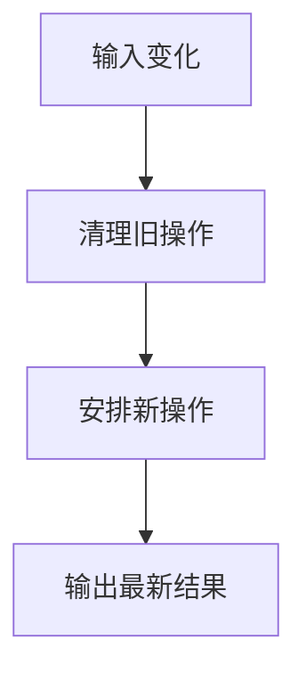

# watch 与副作用清理

> **当前主线**：用户指定的 Vue3＋TS 71 集课程；本篇为主题对照与自主讲解，旧 Vue2 演示保留为迁移参考。
> 示例版本：Vue 3.5.13；版本固定用于复现，不表示最新版本。

---

<span style="background-color:rgb(255, 249, 227)">一：学习目标与使用场景</span>

使用 watch 监听变化，并清理过时的异步操作。

---

<span style="background-color:rgb(255, 249, 227)">二：先把原理讲清楚</span>

watch 适合“状态变了以后执行一件事”，例如保存偏好、发起搜索或调用第三方接口。它与 computed 的职责不同：computed 计算结果，watch 执行副作用。如果只为拼接字符串而写 watch，通常是把派生状态复杂化了。

watch 的第一个参数可以是 ref、reactive 对象、getter 或来源数组。监听对象某个属性时应传 () => state.name，而不是 state.name 的当前普通值。回调可接收新值、旧值和清理注册函数。

快速输入会连续触发变化。如果每次都延迟执行或者发请求，旧操作可能晚于新操作完成，覆盖最新结果。可以在回调中注册清理函数，取消旧计时器或 AbortController。这样每一次监听都负责清理自己创建的资源。

watch 默认不是立即执行；immediate: true 可以在建立监听时先执行一次。默认回调执行时自身组件 DOM 未必已经更新，若要读取更新后的 DOM 可使用 flush: 'post'。deep 会遍历嵌套数据，范围过大可能增加开销。

---

<span style="background-color:rgb(255, 249, 227)">三：运行方式</span>

直接打开同目录下的 [配套演示](示例/08-watch与副作用清理.html)。运行库放在示例/vendor，已本地保存，普通示例不需要联网。Obsidian 的代码块用于阅读，不会自动执行 HTML。也可以把下面整段内容保存到示例目录中的新 HTML 文件；改变位置时需要相应调整运行库相对路径。

---

<span style="background-color:rgb(255, 249, 227)">四：完整代码演示</span>

```html
<!doctype html>
<html lang="zh-CN">
<head>
<meta charset="UTF-8">
<meta name="viewport" content="width=device-width, initial-scale=1">
<title>watch 与副作用清理</title>
<style>
body{font-family:system-ui,sans-serif;line-height:1.7;margin:2rem auto;padding:0 1rem;max-width:58rem;color:#202124;background:#fff}button,input,select{font:inherit;padding:.4rem;margin:.3rem}button{cursor:pointer}label{display:inline-block;margin:.3rem}section{border:1px solid #aaa;padding:1rem;margin:1rem 0}li{margin:.4rem 0}pre{white-space:pre-wrap;overflow-wrap:anywhere}button:focus-visible,a:focus-visible,input:focus-visible,select:focus-visible{outline:3px solid #b45309}.active{background:#166534;color:#fff}nav{display:flex;gap:1rem;flex-wrap:wrap}
</style>
</head>
<body>
<div id="app">
<h1>防抖搜索模拟</h1><input v-model="query" aria-label="关键词" placeholder="快速输入"><p role="status">{{ result }}</p>
</div>
<script src="./vendor/vue-3.5.13.js"></script>
<script>
const { createApp, ref, watch } = Vue;
createApp({ setup() {
  const query = ref(''), result = ref('请输入关键词');
  watch(query, (value, oldValue, onCleanup) => {
    result.value = value ? '等待输入停止…' : '请输入关键词';
    const timer = setTimeout(() => {
      if (value) result.value = '模拟搜索：' + value;
    }, 400);
    onCleanup(() => clearTimeout(timer));
  });
  return {query, result};
}}).mount('#app');
</script>
</body>
</html>
```

---

<span style="background-color:rgb(255, 249, 227)">五：按执行顺序解释</span>

1. 每次 query 改变，watch 回调执行，并创建一个 400ms 延迟任务。
2. 新变化出现时，前一次注册的清理函数先清除旧任务。
3. 回调捕获当次 value，清理机制确保旧输入不会在之后覆盖新输入。
4. 这是模拟搜索，未访问后端；网络实现仍需错误处理和取消机制。

---

<span style="background-color:rgb(255, 249, 227)">六：预期结果与验证步骤</span>

连续输入时提示等待；停止输入约 400ms 后显示最后的关键词，旧关键词不会继续覆盖。

操作时同时打开浏览器开发者工具：Elements 查看模板生成的节点，Console 查看是否有语法错误或 Vue 警告。若页面显示双大括号原文，优先检查运行库路径、脚本加载顺序和挂载目标。

---

<span style="background-color:rgb(255, 249, 227)">七：图解</span>



---

<span style="background-color:rgb(255, 249, 227)">八：注意事项与易错点</span>

- 响应式对象深层修改时，新旧值可能指向同一对象，不是自动生成的深拷贝。
- 在同步 setup 创建的监听会随组件卸载停止；异步创建的监听可能需要手动停止。
- 示例使用回调第三参数清理方式，避免把依赖 Vue 3.5 的 onWatcherCleanup 当成所有版本通用 API。

---

<span style="background-color:rgb(255, 249, 227)">九：动手练习</span>

保留 watch 返回的停止函数，添加“停止搜索”按钮。

<details>
<summary>参考答案与思路（先自己尝试）</summary>

```js
const stop = watch(query, callback);
// 将 stop 从 setup 返回，然后 <button @click="stop">停止搜索</button>
// callback 使用原示例的回调实现。
```

练习片段需要放入本篇已有的模板或 setup 对应位置，不是另一份独立文件。修改后重做上面的验证步骤，并检查空值、重复操作和恢复状态。

</details>

---

<span style="background-color:rgb(255, 249, 227)">十：复习问题</span>

1. 本篇中哪些数据是真正的源状态，哪些是推导结果或 DOM 表示？
2. 如果页面没有按预期更新，应该先检查运行环境、API 版本还是依赖关系？结合示例说明。
3. 能否不用背代码，用自己的话描述图中每一步的输入和输出？


---

<span style="background-color:rgb(255, 249, 227)">十一：相关笔记</span>

[[前端/VUE/07-computed计算属性|上一篇：computed 计算属性]] · [[前端/VUE/09-class与style动态样式|下一篇：class 与 style 动态样式]] · [[前端/VUE/00-Vue学习索引]]

---

<span style="background-color:rgb(255, 249, 227)">十二：官方参考与来源边界</span>

- [Vue 3 中文指南](https://cn.vuejs.org/guide/introduction.html)
- [Vue 2 中文指南](https://v2.cn.vuejs.org/v2/guide/)
- [Vue 2 维护结束说明](https://v2.vuejs.org/eol/)

原有示例和参考继续保留；当前课程目录已另行核验。没有取得字幕，不将自主讲解声称为视频逐字内容。

---

<span style="background-color:rgb(255, 249, 227)">专题深化：watch 的源与清理时机</span>

监视 `ref` 可直接传 ref；监视某个属性常用 getter，例如 `watch(() => state.id, ...)`，不能传 `state.id` 当前读出的普通数字。直接传 reactive 对象和传返回对象的 getter，在默认深度行为上也不同。

**异步场景**：id 改变后启动请求，旧请求可能更晚返回。用回调的 onCleanup 中止旧请求，或用序号拒绝过时结果。主动取消不应显示为网络失败。

深度监视的 oldValue 与 newValue 在对象内部变更时可能是同一引用，它不是自动生成的前后快照。Vue3.5 的 `onWatcherCleanup` 必须在同步执行阶段注册；回调参数 onCleanup 是另一种清理入口，应分清限制。

- [指定课程 P17—P22](https://www.bilibili.com/video/BV1Za4y1r7KE/?p=17)
- [[前端/VUE/00-课程目录与来源说明|已核验的完整分集目录与来源边界]]
- [Vue 官方指南](https://vuejs.org/guide/introduction.html)
- [Vue 与 TypeScript](https://vuejs.org/guide/typescript/composition-api.html)
