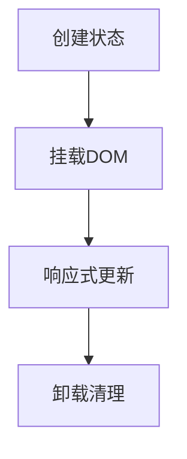

# 生命周期与 nextTick

> **当前主线**：用户指定的 Vue3＋TS 71 集课程；本篇为主题对照与自主讲解，旧 Vue2 演示保留为迁移参考。
> 示例版本：Vue 3.5.13；版本固定用于复现，不表示最新版本。

---

<span style="background-color:rgb(255, 249, 227)">一：学习目标与使用场景</span>

知道什么时候能访问 DOM、什么时候清理资源，以及怎样等待 DOM 更新。

---

<span style="background-color:rgb(255, 249, 227)">二：先把原理讲清楚</span>

组件不是一直存在的。它经历初始化、挂载、更新和卸载。初始化阶段适合建立状态；挂载后才可以可靠访问模板中的真实节点；卸载前后应清理计时器、观察器和组件外部监听器。

Vue 3 Composition API 使用 onMounted、onUpdated、onUnmounted 等函数注册钩子。这些注册应在 setup 的同步执行期间发生。Options API 中则是 mounted、updated、beforeUnmount 等选项，Vue 2 卸载钩子名称为 beforeDestroy/destroyed。

改变 ref 后，JavaScript 状态马上改变，但 Vue 通常把同一轮修改批量合并再更新 DOM。nextTick 返回一个 Promise，在当前已经排队的 DOM 更新完成后恢复执行。它用于等待 Vue 更新，不等于等待图片加载、网络完成或浏览器下一帧绘制。

DOM 引用通过 ref 属性连接：模板 ref="field" 与 setup 中 field = ref(null) 对应。节点受 v-if 控制时可能随时变回 null，所以访问前应判断。不要依赖元素全局 ID 自动变成变量的浏览器兼容行为。

---

<span style="background-color:rgb(255, 249, 227)">三：运行方式</span>

直接打开同目录下的 [配套演示](示例/10-生命周期与nextTick.html)。运行库放在示例/vendor，已本地保存，普通示例不需要联网。Obsidian 的代码块用于阅读，不会自动执行 HTML。也可以把下面整段内容保存到示例目录中的新 HTML 文件；改变位置时需要相应调整运行库相对路径。

---

<span style="background-color:rgb(255, 249, 227)">四：完整代码演示</span>

```html
<!doctype html>
<html lang="zh-CN">
<head>
<meta charset="UTF-8">
<meta name="viewport" content="width=device-width, initial-scale=1">
<title>生命周期与 nextTick</title>
<style>
body{font-family:system-ui,sans-serif;line-height:1.7;margin:2rem auto;padding:0 1rem;max-width:58rem;color:#202124;background:#fff}button,input,select{font:inherit;padding:.4rem;margin:.3rem}button{cursor:pointer}label{display:inline-block;margin:.3rem}section{border:1px solid #aaa;padding:1rem;margin:1rem 0}li{margin:.4rem 0}pre{white-space:pre-wrap;overflow-wrap:anywhere}button:focus-visible,a:focus-visible,input:focus-visible,select:focus-visible{outline:3px solid #b45309}.active{background:#166534;color:#fff}nav{display:flex;gap:1rem;flex-wrap:wrap}
</style>
</head>
<body>
<div id="app">
<h1>DOM 更新实验</h1><p ref="text">{{ count }}</p><button @click="update">更新并读取</button><pre>{{ log }}</pre><label>自动聚焦 <input ref="field"></label>
</div>
<script src="./vendor/vue-3.5.13.js"></script>
<script>
const {createApp, ref, onMounted, nextTick} = Vue;
createApp({setup(){
  const count = ref(0), text = ref(null), field = ref(null), log = ref('');
  onMounted(() => field.value?.focus());
  async function update(){
    count.value++;
    const before = text.value.textContent;
    await nextTick();
    log.value = '更新前 DOM=' + before + '；更新后 DOM=' + text.value.textContent;
  }
  return {count,text,field,log,update};
}}).mount('#app');
</script>
</body>
</html>
```

---

<span style="background-color:rgb(255, 249, 227)">五：按执行顺序解释</span>

1. 模板把真实 p 和 input 节点交给 text、field 两个 ref。
2. onMounted 运行时输入框已经创建，可以调用 focus。
3. 更新函数先保存旧 DOM 文本，再 await nextTick 等待 Vue 刷新。
4. 记录结果中的两次文本不同，体现状态修改与 DOM 刷新不是同一瞬间。

---

<span style="background-color:rgb(255, 249, 227)">六：预期结果与验证步骤</span>

页面打开时输入框获得焦点。第一次点击后显示“更新前 DOM=0；更新后 DOM=1”。

操作时同时打开浏览器开发者工具：Elements 查看模板生成的节点，Console 查看是否有语法错误或 Vue 警告。若页面显示双大括号原文，优先检查运行库路径、脚本加载顺序和挂载目标。

---

<span style="background-color:rgb(255, 249, 227)">七：图解</span>



---

<span style="background-color:rgb(255, 249, 227)">八：注意事项与易错点</span>

- updated 中无条件修改相关状态，可能造成无限更新循环。
- 清理全局 window 监听器时必须使用相同函数引用。
- 不要把 Vue 2 destroyed 钩子直接复制到 Vue 3 期望它执行。

---

<span style="background-color:rgb(255, 249, 227)">九：动手练习</span>

挂载时启动时钟，卸载时停止计时器。

<details>
<summary>参考答案与思路（先自己尝试）</summary>

```js
let timer;
onMounted(() => { timer = setInterval(() => count.value++, 1000); });
onUnmounted(() => clearInterval(timer));
// 需要先从 Vue 解构 onUnmounted。
```

练习片段需要放入本篇已有的模板或 setup 对应位置，不是另一份独立文件。修改后重做上面的验证步骤，并检查空值、重复操作和恢复状态。

</details>

---

<span style="background-color:rgb(255, 249, 227)">十：复习问题</span>

1. 本篇中哪些数据是真正的源状态，哪些是推导结果或 DOM 表示？
2. 如果页面没有按预期更新，应该先检查运行环境、API 版本还是依赖关系？结合示例说明。
3. 能否不用背代码，用自己的话描述图中每一步的输入和输出？


---

<span style="background-color:rgb(255, 249, 227)">十一：相关笔记</span>

[[前端/VUE/09-class与style动态样式|上一篇：class 与 style 动态样式]] · [[前端/VUE/11-组件props与自定义事件|下一篇：组件 props 与自定义事件]] · [[前端/VUE/00-Vue学习索引]]

---

<span style="background-color:rgb(255, 249, 227)">十二：官方参考与来源边界</span>

- [Vue 3 中文指南](https://cn.vuejs.org/guide/introduction.html)
- [Vue 2 中文指南](https://v2.cn.vuejs.org/v2/guide/)
- [Vue 2 维护结束说明](https://v2.vuejs.org/eol/)

原有示例和参考继续保留；当前课程目录已另行核验。没有取得字幕，不将自主讲解声称为视频逐字内容。

---

<span style="background-color:rgb(255, 249, 227)">专题深化：生命周期与 DOM 提交顺序</span>

setup 执行时尚不能假定模板 DOM 已挂载。onMounted 用于依赖真实 DOM 的初始化；onUnmounted 清理定时器、事件和外部实例。同步 setup 中注册生命周期，避免在异步回调中错过当前实例上下文。

`nextTick` 等待 Vue 当前批次 DOM 更新，不等于等待网络完成、图片加载或所有动画结束。调用顺序应是修改状态 → await nextTick → 测量元素；外部图表还可能需要自己的完成事件。

**C++17 对照**：生命周期清理可借用 RAII 的资源责任意识，但卸载钩子不是语言析构函数，必须由组件实际挂载/卸载过程触发。

- [指定课程 P23、P26—P28](https://www.bilibili.com/video/BV1Za4y1r7KE/?p=23)
- [[前端/VUE/00-课程目录与来源说明|已核验的完整分集目录与来源边界]]
- [Vue 官方指南](https://vuejs.org/guide/introduction.html)
- [Vue 与 TypeScript](https://vuejs.org/guide/typescript/composition-api.html)
