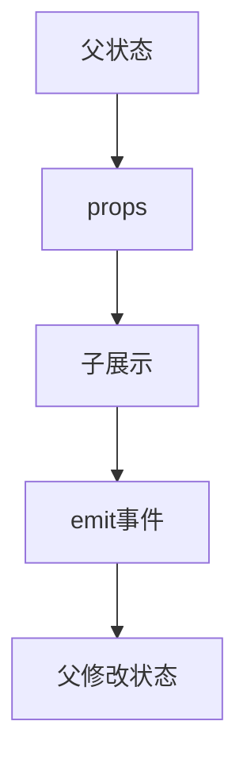

# 组件 props 与自定义事件

> **当前主线**：用户指定的 Vue3＋TS 71 集课程；本篇为主题对照与自主讲解，旧 Vue2 演示保留为迁移参考。
> 示例版本：Vue 3.5.13；版本固定用于复现，不表示最新版本。

---

<span style="background-color:rgb(255, 249, 227)">一：学习目标与使用场景</span>

建立父传子、子通知父的数据流，并掌握组件 v-model 的版本差异。

---

<span style="background-color:rgb(255, 249, 227)">二：先把原理讲清楚</span>

组件把页面拆成可以独立理解的界面单元。父组件拥有某个状态时，通过 props 把值交给子组件。子组件需要修改这个状态，应发送事件表达意图，由父组件决定如何更新；这就是常说的单向数据流。

props 在子组件中应视为只读。即使一个对象 prop 的内部字段技术上可以被修改，也会让父子之间产生难追踪的隐式依赖。优先通过事件发送新值或操作意图，使修改位置清楚。

Vue 3 组件的默认 v-model 对应 modelValue prop 与 update:modelValue 事件；Vue 2 默认对应 value 与 input。只改模板中的变量名而不改事件名，会让组件看起来正常展示但无法回传输入。

声明 emits 可以记录组件会发出的事件，并帮助区分原生属性透传和自定义事件。事件名称建议统一使用 kebab-case。在浏览器 DOM 模板中，组件标签也推荐使用 kebab-case 且明确写结束标签，避免 HTML 解析器把自闭合标签吞并。

---

<span style="background-color:rgb(255, 249, 227)">三：运行方式</span>

直接打开同目录下的 [配套演示](示例/11-组件props与自定义事件.html)。运行库放在示例/vendor，已本地保存，普通示例不需要联网。Obsidian 的代码块用于阅读，不会自动执行 HTML。也可以把下面整段内容保存到示例目录中的新 HTML 文件；改变位置时需要相应调整运行库相对路径。

---

<span style="background-color:rgb(255, 249, 227)">四：完整代码演示</span>

```html
<!doctype html>
<html lang="zh-CN">
<head>
<meta charset="UTF-8">
<meta name="viewport" content="width=device-width, initial-scale=1">
<title>组件 props 与自定义事件</title>
<style>
body{font-family:system-ui,sans-serif;line-height:1.7;margin:2rem auto;padding:0 1rem;max-width:58rem;color:#202124;background:#fff}button,input,select{font:inherit;padding:.4rem;margin:.3rem}button{cursor:pointer}label{display:inline-block;margin:.3rem}section{border:1px solid #aaa;padding:1rem;margin:1rem 0}li{margin:.4rem 0}pre{white-space:pre-wrap;overflow-wrap:anywhere}button:focus-visible,a:focus-visible,input:focus-visible,select:focus-visible{outline:3px solid #b45309}.active{background:#166534;color:#fff}nav{display:flex;gap:1rem;flex-wrap:wrap}
</style>
</head>
<body>
<div id="app">
<h1>父子计数</h1><p>父级记录：{{ total }}</p><counter-button :count="total" @increment="total++"></counter-button>
</div>
<script src="./vendor/vue-3.5.13.js"></script>
<script>
const {createApp, ref} = Vue;
const CounterButton = {
  props: {count: {type: Number, required: true}},
  emits: ['increment'],
  methods: {increment(){this.$emit('increment');}},
  template: '<button @click="increment">子组件请求加一：{{ count }}</button>'
};
createApp({
  components: {CounterButton},
  setup(){ const total = ref(0); return {total}; }
}).mount('#app');
</script>
</body>
</html>
```

---

<span style="background-color:rgb(255, 249, 227)">五：按执行顺序解释</span>

1. 父组件将 total 通过 :count 传入，子组件用 props 声明输入。
2. 子按钮不写 count++，只发送 increment 事件。
3. 父组件 @increment="total++" 是真正修改状态的位置。
4. 状态更新后新的 count 又传给子组件，构成可预测的闭环。

---

<span style="background-color:rgb(255, 249, 227)">六：预期结果与验证步骤</span>

点击子组件按钮，父级数字和子按钮上的数字都递增，父组件保持状态所有权。

操作时同时打开浏览器开发者工具：Elements 查看模板生成的节点，Console 查看是否有语法错误或 Vue 警告。若页面显示双大括号原文，优先检查运行库路径、脚本加载顺序和挂载目标。

---

<span style="background-color:rgb(255, 249, 227)">七：图解</span>



---

<span style="background-color:rgb(255, 249, 227)">八：注意事项与易错点</span>

- 不要直接给 props 赋值，也不要滥用父组件引用绕过事件通信。
- 默认组件 v-model：Vue 2 是 value/input，Vue 3 是 modelValue/update:modelValue。
- Vue 3.4+ 的 defineModel 是 script setup 编译宏，不能直接写到这个无构建 CDN 示例中。

---

<span style="background-color:rgb(255, 249, 227)">九：动手练习</span>

增加 reset 事件，父级收到后将 total 重置为 0。

<details>
<summary>参考答案与思路（先自己尝试）</summary>

```js
// 子组件：emits: ['increment', 'reset']
// 子模板追加：<button @click="$emit('reset')">重置</button>
// 父模板：@reset="total = 0"
```

练习片段需要放入本篇已有的模板或 setup 对应位置，不是另一份独立文件。修改后重做上面的验证步骤，并检查空值、重复操作和恢复状态。

</details>

---

<span style="background-color:rgb(255, 249, 227)">十：复习问题</span>

1. 本篇中哪些数据是真正的源状态，哪些是推导结果或 DOM 表示？
2. 如果页面没有按预期更新，应该先检查运行环境、API 版本还是依赖关系？结合示例说明。
3. 能否不用背代码，用自己的话描述图中每一步的输入和输出？


---

<span style="background-color:rgb(255, 249, 227)">十一：相关笔记</span>

[[前端/VUE/10-生命周期与nextTick|上一篇：生命周期与 nextTick]] · [[前端/VUE/12-slot插槽与作用域插槽|下一篇：slot 插槽与作用域插槽]] · [[前端/VUE/00-Vue学习索引]]

---

<span style="background-color:rgb(255, 249, 227)">十二：官方参考与来源边界</span>

- [Vue 3 中文指南](https://cn.vuejs.org/guide/introduction.html)
- [Vue 2 中文指南](https://v2.cn.vuejs.org/v2/guide/)
- [Vue 2 维护结束说明](https://v2.vuejs.org/eol/)

原有示例和参考继续保留；当前课程目录已另行核验。没有取得字幕，不将自主讲解声称为视频逐字内容。

---

<span style="background-color:rgb(255, 249, 227)">专题深化：props 契约与事件载荷</span>

props 是父到子的输入，emits 是子到父的意图通知。子组件接到对象后修改其嵌套字段，运行时可能影响父组件，但这会隐藏写入路径；推荐发出事件，让状态所有者决定怎么更新。

TS 既能描述 prop 结构，也能限制事件名及载荷，例如 `defineEmits<{ remove: [id: number] }>()`。不需要把所有组件都写成泛型；先把真实公共边界写清楚。

**排错顺序**：父是否传对名称 → 子声明是否匹配 → emit 是否真的触发 → 父监听是否收到同一载荷 → 更新是否作用到源状态。不要把 DOM 的冒泡直觉套到组件事件上。

- [指定课程 P24—P25、P52—P53](https://www.bilibili.com/video/BV1Za4y1r7KE/?p=24)
- [[前端/VUE/00-课程目录与来源说明|已核验的完整分集目录与来源边界]]
- [Vue 官方指南](https://vuejs.org/guide/introduction.html)
- [Vue 与 TypeScript](https://vuejs.org/guide/typescript/composition-api.html)
