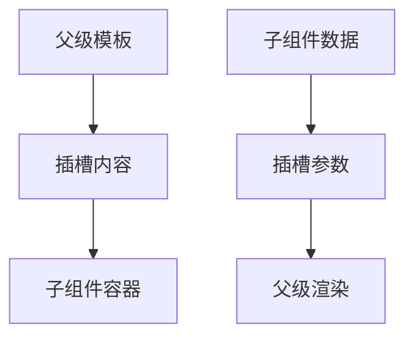

# slot 插槽与作用域插槽

> **当前主线**：用户指定的 Vue3＋TS 71 集课程；本篇为主题对照与自主讲解，旧 Vue2 演示保留为迁移参考。
> 示例版本：Vue 3.5.13；版本固定用于复现，不表示最新版本。

---

<span style="background-color:rgb(255, 249, 227)">一：学习目标与使用场景</span>

用插槽传递内容，用作用域插槽把子组件数据交给父组件决定如何展示。

---

<span style="background-color:rgb(255, 249, 227)">二：先把原理讲清楚</span>

props 适合传数据，slot 适合传一段界面结构。例如弹窗拥有统一的容器和关闭逻辑，但内部标题、表单和操作按钮由使用者决定。把这些内容写死在组件里会失去复用能力。

默认插槽名是 default；具名插槽用 name 区分，父级使用 template #header 等语法提供内容。插槽可以提供后备内容：当父级没有传入时才显示。不同插槽分别表达不同职责，比传入一整段 HTML 字符串更清楚也更安全。

插槽内容默认在父组件的作用域中解释，不能随意读取子组件内部变量。如果子组件希望父级决定如何展示内部数据，就要在 slot 上绑定属性，再由父级通过 #default="slotProps" 接收，这就是作用域插槽。

可以把作用域插槽理解为函数：子组件调用父级提供的“渲染函数”，同时把数据作为参数交过去。父级可以使用自己的变量，也可以使用传入参数；两种来源在代码中应该明确区分。

---

<span style="background-color:rgb(255, 249, 227)">三：运行方式</span>

直接打开同目录下的 [配套演示](示例/12-slot插槽与作用域插槽.html)。运行库放在示例/vendor，已本地保存，普通示例不需要联网。Obsidian 的代码块用于阅读，不会自动执行 HTML。也可以把下面整段内容保存到示例目录中的新 HTML 文件；改变位置时需要相应调整运行库相对路径。

---

<span style="background-color:rgb(255, 249, 227)">四：完整代码演示</span>

```html
<!doctype html>
<html lang="zh-CN">
<head>
<meta charset="UTF-8">
<meta name="viewport" content="width=device-width, initial-scale=1">
<title>slot 插槽与作用域插槽</title>
<style>
body{font-family:system-ui,sans-serif;line-height:1.7;margin:2rem auto;padding:0 1rem;max-width:58rem;color:#202124;background:#fff}button,input,select{font:inherit;padding:.4rem;margin:.3rem}button{cursor:pointer}label{display:inline-block;margin:.3rem}section{border:1px solid #aaa;padding:1rem;margin:1rem 0}li{margin:.4rem 0}pre{white-space:pre-wrap;overflow-wrap:anywhere}button:focus-visible,a:focus-visible,input:focus-visible,select:focus-visible{outline:3px solid #b45309}.active{background:#166534;color:#fff}nav{display:flex;gap:1rem;flex-wrap:wrap}
</style>
</head>
<body>
<div id="app">
<h1>插槽示例</h1><info-panel><template #header><h2>我的清单</h2></template><template #default="{ count }"><p>组件内部统计：{{ count }}；父级标题：{{ title }}</p></template></info-panel>
</div>
<script src="./vendor/vue-3.5.13.js"></script>
<script>
const {createApp, ref} = Vue;
const InfoPanel = {
  setup(){const count = ref(3); return {count};},
  template: '<section><header><slot name="header">默认标题</slot></header><slot :count="count">默认内容</slot></section>'
};
createApp({components:{InfoPanel},setup(){return {title:'前端笔记'};}}).mount('#app');
</script>
</body>
</html>
```

---

<span style="background-color:rgb(255, 249, 227)">五：按执行顺序解释</span>

1. 子组件的 header 插槽保留标题位置，父组件提供 h2 替换后备文本。
2. 默认 slot 通过 :count 把内部数字暴露给父级。
3. 父级 #default="{ count }" 解构插槽参数；这里的 count 来自子级。
4. title 来自父级 setup，说明插槽模板仍以父作用域为基础。

---

<span style="background-color:rgb(255, 249, 227)">六：预期结果与验证步骤</span>

页面显示“我的清单”和“组件内部统计：3；父级标题：前端笔记”。

操作时同时打开浏览器开发者工具：Elements 查看模板生成的节点，Console 查看是否有语法错误或 Vue 警告。若页面显示双大括号原文，优先检查运行库路径、脚本加载顺序和挂载目标。

---

<span style="background-color:rgb(255, 249, 227)">七：图解</span>



---

<span style="background-color:rgb(255, 249, 227)">八：注意事项与易错点</span>

- v-slot 的 # 缩写与旧版 slot-scope 不应混用；Vue 2.6+ 支持 v-slot。
- 插槽属性是子组件暴露的接口，不是让父级随意访问所有内部变量。
- 不要用 v-html 代替结构化插槽处理用户提供内容。

---

<span style="background-color:rgb(255, 249, 227)">九：动手练习</span>

添加 footer 具名插槽，未传入时显示“暂无操作”。

<details>
<summary>参考答案与思路（先自己尝试）</summary>

```js
// 子模板末尾加：<footer><slot name="footer">暂无操作</slot></footer>
// 父组件可选提供：<template #footer><button>确认</button></template>
```

练习片段需要放入本篇已有的模板或 setup 对应位置，不是另一份独立文件。修改后重做上面的验证步骤，并检查空值、重复操作和恢复状态。

</details>

---

<span style="background-color:rgb(255, 249, 227)">十：复习问题</span>

1. 本篇中哪些数据是真正的源状态，哪些是推导结果或 DOM 表示？
2. 如果页面没有按预期更新，应该先检查运行环境、API 版本还是依赖关系？结合示例说明。
3. 能否不用背代码，用自己的话描述图中每一步的输入和输出？


---

<span style="background-color:rgb(255, 249, 227)">十一：相关笔记</span>

[[前端/VUE/11-组件props与自定义事件|上一篇：组件 props 与自定义事件]] · [[前端/VUE/13-ref-reactive与组合式API|下一篇：ref、reactive 与组合式 API]] · [[前端/VUE/00-Vue学习索引]]

---

<span style="background-color:rgb(255, 249, 227)">十二：官方参考与来源边界</span>

- [Vue 3 中文指南](https://cn.vuejs.org/guide/introduction.html)
- [Vue 2 中文指南](https://v2.cn.vuejs.org/v2/guide/)
- [Vue 2 维护结束说明](https://v2.vuejs.org/eol/)

原有示例和参考继续保留；当前课程目录已另行核验。没有取得字幕，不将自主讲解声称为视频逐字内容。

---

<span style="background-color:rgb(255, 249, 227)">专题深化：插槽拥有内容作用域，子组件提供数据</span>

默认/具名插槽把渲染内容的选择权交给调用方；作用域插槽再把子组件内部选定的数据以 slot props 提供给调用方。父模板里的名字默认来自父作用域，不会因为内容被插到子组件就自动能读到子状态。

**小例子**：子列表对每个 item 调用 `<slot :item="item" />`；父组件通过 `#default="{ item }"` 取得这次渲染的数据。这里不是复制一份全局 item，而是一次次调用渲染函数时的参数。

需要传数据就用 props；需要传一段界面结构时用 slot。两者常配合使用，不是彼此替代。

- [指定课程 P61—P63](https://www.bilibili.com/video/BV1Za4y1r7KE/?p=61)
- [[前端/VUE/00-课程目录与来源说明|已核验的完整分集目录与来源边界]]
- [Vue 官方指南](https://vuejs.org/guide/introduction.html)
- [Vue 与 TypeScript](https://vuejs.org/guide/typescript/composition-api.html)
