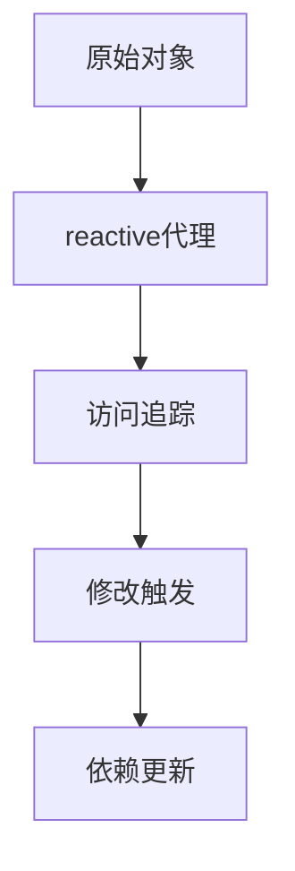

# ref、reactive 与组合式 API

> 课程范围：P117 至最后（用户指定）。未取得视频逐集标题与字幕，本篇为自主编写的知识体系笔记，不代表逐集内容已核验。
> 示例版本：Vue 3.5.13；版本固定用于复现，不表示最新版本。

## 学习目标与使用场景

理解响应式代理、解构陷阱和组合函数的基本边界。

## 先把原理讲清楚

ref 可以包装原始值和对象，脚本通过 value 访问；reactive 主要把对象包装成响应式代理。Vue 3 追踪的是代理上的访问与修改，不是任意同名的普通变量。保持响应式引用链比记住大量 API 名称更重要。

对 reactive 对象解构普通数值字段，会把当前数值复制到新变量里，后续修改原对象不会自动改变这份副本。toRefs(state) 可以把每个属性转换成与原属性关联的 ref；需要保持字段联动时可使用它。

ref 包装对象时，替换整个 .value 是常用做法。reactive 则通常保持代理对象本身稳定，更新属性或使用 Object.assign。若把变量重新指向一个全新普通对象，原来依赖的代理关系可能断开。

组合函数是把一组相关响应式逻辑组织成可复用函数，常以 use 开头。例如 useCounter 返回 count、increment，让多个组件复用行为。函数内创建状态代表每次调用各自独立；模块顶层创建状态则是共享状态，二者要有意选择。

## 运行方式

直接打开同目录下的 [配套演示](示例/13-ref-reactive与组合式API.html)。运行库放在示例/vendor，已本地保存，普通示例不需要联网。Obsidian 的代码块用于阅读，不会自动执行 HTML。也可以把下面整段内容保存到示例目录中的新 HTML 文件；改变位置时需要相应调整运行库相对路径。

## 完整代码演示

```html
<!doctype html>
<html lang="zh-CN">
<head>
<meta charset="UTF-8">
<meta name="viewport" content="width=device-width, initial-scale=1">
<title>ref、reactive 与组合式 API</title>
<style>
body{font-family:system-ui,sans-serif;line-height:1.7;margin:2rem auto;padding:0 1rem;max-width:58rem;color:#202124;background:#fff}button,input,select{font:inherit;padding:.4rem;margin:.3rem}button{cursor:pointer}label{display:inline-block;margin:.3rem}section{border:1px solid #aaa;padding:1rem;margin:1rem 0}li{margin:.4rem 0}pre{white-space:pre-wrap;overflow-wrap:anywhere}button:focus-visible,a:focus-visible,input:focus-visible,select:focus-visible{outline:3px solid #b45309}.active{background:#166534;color:#fff}nav{display:flex;gap:1rem;flex-wrap:wrap}
</style>
</head>
<body>
<div id="app">
<h1>代理与解构</h1><p>state.count：{{ state.count }}</p><p>普通快照：{{ snapshot }}</p><p>toRefs 关联：{{ count }}</p><button @click="state.count++">增加</button>
</div>
<script src="./vendor/vue-3.5.13.js"></script>
<script>
const {createApp, reactive, toRefs} = Vue;
createApp({setup(){
  const state = reactive({count:0});
  const snapshot = state.count;
  const {count} = toRefs(state);
  return {state,snapshot,count};
}}).mount('#app');
</script>
</body>
</html>
```

## 按执行顺序解释

1. state 是代理，访问 state.count 时 Vue 可以收集依赖。
2. snapshot 是取值时的数字 0，它不会因为来源变化而自动变化。
3. toRefs 返回的 count ref 仍然指向 state.count，读写会联动。
4. 模板中解包 count，点击后它与 state.count 一起改变，snapshot 保持 0。

## 预期结果与验证步骤

点击三次后，state.count 和 toRefs 关联都显示 3，普通快照仍显示 0。

操作时同时打开浏览器开发者工具：Elements 查看模板生成的节点，Console 查看是否有语法错误或 Vue 警告。若页面显示双大括号原文，优先检查运行库路径、脚本加载顺序和挂载目标。

## 图解



## 注意事项与易错点

- reactive 不能直接包装数字并达到预期，应使用 ref。
- 不要把所有对象解构都当成错误；关键是解构结果是否仍然是 ref 或其他响应式引用。
- Vue 2.7 提供部分 Composition API，但仍保留 Vue 2 响应式限制，不等于完整 Vue 3。

## 动手练习

写 useCounter，让两个按钮拥有各自独立计数。

<details>
<summary>参考答案与思路（先自己尝试）</summary>

```js
function useCounter(){
  const count = Vue.ref(0);
  const increment = () => count.value++;
  return {count, increment};
}
// setup 内分别调用两次并返回结果。
```

练习片段需要放入本篇已有的模板或 setup 对应位置，不是另一份独立文件。修改后重做上面的验证步骤，并检查空值、重复操作和恢复状态。

</details>

## 复习问题

1. 本篇中哪些数据是真正的源状态，哪些是推导结果或 DOM 表示？
2. 如果页面没有按预期更新，应该先检查运行环境、API 版本还是依赖关系？结合示例说明。
3. 能否不用背代码，用自己的话描述图中每一步的输入和输出？


## 相关笔记

[[前端/VUE/12-slot插槽与作用域插槽|上一篇：slot 插槽与作用域插槽]] · [[前端/VUE/14-Vue2与OptionsAPI完整示例|下一篇：Vue 2 与 Options API 完整示例]] · [[前端/VUE/00-Vue学习索引]]

## 官方参考与来源边界

- [Vue 3 中文指南](https://cn.vuejs.org/guide/introduction.html)
- [Vue 2 中文指南](https://v2.cn.vuejs.org/v2/guide/)
- [Vue 2 维护结束说明](https://v2.vuejs.org/eol/)

以上文档用于核对 API 和版本差异；课程链接与集数只来自用户指定范围，未据此编造每集标题或台词。
