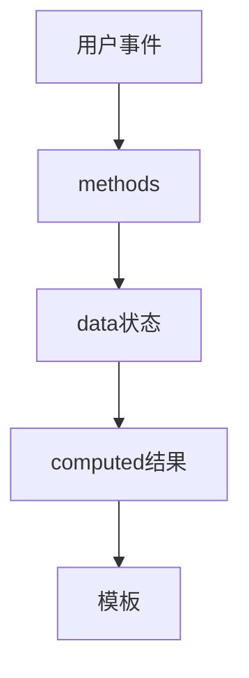

# Vue 2 与 Options API 完整示例

> **当前主线**：用户指定的 Vue3＋TS 71 集课程；本篇为主题对照与自主讲解，旧 Vue2 演示保留为迁移参考。
> 示例版本：Vue 2.7.16（仅用于旧课程对照）；版本固定用于复现，不表示最新版本。

---

<span style="background-color:rgb(255, 249, 227)">一：学习目标与使用场景</span>

认识 data、methods、computed、watch 和生命周期，并理解 Options API 不等于过时语法。

---

<span style="background-color:rgb(255, 249, 227)">二：先把原理讲清楚</span>

Options API 按职责分类组织组件：data 保存状态，methods 放操作，computed 放派生数据，watch 监听变化，mounted 等钩子处理生命周期。学习旧课程时，先找到每段代码属于哪个选项，通常比逐行记忆更容易理解。

Vue 2 通过 new Vue 初始化根实例，el 指定挂载点；组件中的 data 必须是返回新对象的函数，这样多个实例不会意外共享同一份数据。根实例也统一使用函数形式，可减少初学时的规则差异。

普通 methods、computed 和生命周期中的 this 指向当前组件实例，因此可以写 this.keyword。不能把需要 this 的方法写成箭头函数：箭头函数没有自己的 this，会捕获外层作用域，导致找不到组件数据。

Vue 3 仍支持 Options API。版本与代码风格是两个维度：Vue 3 可以写 data/methods，也可以写 setup；Vue 2.7 有部分组合式能力。判断版本要看依赖和初始化方式，不能看到 methods 就说是 Vue 2。Vue 2 已结束官方维护，旧版笔记用于看懂课程和维护存量项目。

---

<span style="background-color:rgb(255, 249, 227)">三：运行方式</span>

直接打开同目录下的 [配套演示](示例/14-Vue2与OptionsAPI完整示例.html)。运行库放在示例/vendor，已本地保存，普通示例不需要联网。Obsidian 的代码块用于阅读，不会自动执行 HTML。也可以把下面整段内容保存到示例目录中的新 HTML 文件；改变位置时需要相应调整运行库相对路径。

---

<span style="background-color:rgb(255, 249, 227)">四：完整代码演示</span>

```html
<!doctype html>
<html lang="zh-CN">
<head>
<meta charset="UTF-8">
<meta name="viewport" content="width=device-width, initial-scale=1">
<title>Vue 2 与 Options API 完整示例</title>
<style>
body{font-family:system-ui,sans-serif;line-height:1.7;margin:2rem auto;padding:0 1rem;max-width:58rem;color:#202124;background:#fff}button,input,select{font:inherit;padding:.4rem;margin:.3rem}button{cursor:pointer}label{display:inline-block;margin:.3rem}section{border:1px solid #aaa;padding:1rem;margin:1rem 0}li{margin:.4rem 0}pre{white-space:pre-wrap;overflow-wrap:anywhere}button:focus-visible,a:focus-visible,input:focus-visible,select:focus-visible{outline:3px solid #b45309}.active{background:#166534;color:#fff}nav{display:flex;gap:1rem;flex-wrap:wrap}
</style>
</head>
<body>
<div id="app">
<h1>Vue 2 搜索列表</h1><input v-model.trim="keyword" aria-label="搜索课程"><p>结果 {{ filtered.length }} 项</p><ul><li v-for="name in filtered" :key="name">{{ name }}</li></ul><button @click="reset">重置</button><p>{{ message }}</p>
</div>
<script src="./vendor/vue-2.7.16.js"></script>
<script>
new Vue({
  el:'#app',
  data(){return {keyword:'', courses:['HTML','CSS','JavaScript','Vue'], message:'未修改'};},
  computed:{
    filtered(){ return this.courses.filter(name => name.toLowerCase().includes(this.keyword.toLowerCase())); }
  },
  watch:{keyword(value){this.message = '关键词：' + value;}},
  methods:{reset(){this.keyword = '';}}
});
</script>
</body>
</html>
```

---

<span style="background-color:rgb(255, 249, 227)">五：按执行顺序解释</span>

1. data 返回每个实例自己的状态对象。
2. computed.filtered 读取 courses 和 keyword，输出筛选结果。
3. watch 不负责生成结果，只记录关键词变化后的提示信息。
4. reset 使用普通方法语法，因此 this.keyword 指向当前实例字段。

---

<span style="background-color:rgb(255, 249, 227)">六：预期结果与验证步骤</span>

页面初始显示四门课程，输入 css 后仅显示 CSS，点击重置恢复四项。

操作时同时打开浏览器开发者工具：Elements 查看模板生成的节点，Console 查看是否有语法错误或 Vue 警告。若页面显示双大括号原文，优先检查运行库路径、脚本加载顺序和挂载目标。

---

<span style="background-color:rgb(255, 249, 227)">七：图解</span>



---

<span style="background-color:rgb(255, 249, 227)">八：注意事项与易错点</span>

- 此页必须使用 Vue 2.7.16 运行库，不能混用 Vue 3 createApp。
- Vue 2 生命周期销毁钩子为 beforeDestroy 和 destroyed，Vue 3 为 beforeUnmount 和 unmounted。
- Vue 2 已于 2023-12-31 结束官方维护；新项目优先考虑仍维护的技术方案。

---

<span style="background-color:rgb(255, 249, 227)">九：动手练习</span>

增加一个区分大小写的复选框，并让计算属性根据它筛选。

<details>
<summary>参考答案与思路（先自己尝试）</summary>

```js
// data 返回值增加 caseSensitive:false
// computed 中根据 this.caseSensitive 决定是否 toLowerCase()
// <input type="checkbox" v-model="caseSensitive">区分大小写
```

练习片段需要放入本篇已有的模板或 setup 对应位置，不是另一份独立文件。修改后重做上面的验证步骤，并检查空值、重复操作和恢复状态。

</details>

---

<span style="background-color:rgb(255, 249, 227)">十：复习问题</span>

1. 本篇中哪些数据是真正的源状态，哪些是推导结果或 DOM 表示？
2. 如果页面没有按预期更新，应该先检查运行环境、API 版本还是依赖关系？结合示例说明。
3. 能否不用背代码，用自己的话描述图中每一步的输入和输出？


---

<span style="background-color:rgb(255, 249, 227)">十一：相关笔记</span>

[[前端/VUE/13-ref-reactive与组合式API|上一篇：ref、reactive 与组合式 API]] · [[前端/VUE/15-Vue2响应式限制与set|下一篇：Vue 2 响应式限制与 $set]] · [[前端/VUE/00-Vue学习索引]]

---

<span style="background-color:rgb(255, 249, 227)">十二：官方参考与来源边界</span>

- [Vue 3 中文指南](https://cn.vuejs.org/guide/introduction.html)
- [Vue 2 中文指南](https://v2.cn.vuejs.org/v2/guide/)
- [Vue 2 维护结束说明](https://v2.vuejs.org/eol/)

原有示例和参考继续保留；当前课程目录已另行核验。没有取得字幕，不将自主讲解声称为视频逐字内容。

---

<span style="background-color:rgb(255, 249, 227)">专题深化：旧 API 留作迁移，不混版本</span>

Options API 的 data、methods、computed 按选项归类；Composition API 按业务逻辑组织依赖。二者并非“一个能响应式、一个不能”，也不是代码越少越先进。迁移先保持行为，再逐步提取逻辑。

Vue2 示例的 `new Vue`、实例全局 API 与 Vue3 的 createApp 不应混在同一段代码中。Vue2 的 this 与 setup 的上下文也不同，setup 中不能把 this 当作组件实例访问。

本篇保留的 Vue2 演示用于读旧项目；新主线参考 Vue3 课程与本目录的 TS 工程，避免将 Vue2 写法当作新项目默认方案。

- [指定课程 P6、P9、P27、P71](https://www.bilibili.com/video/BV1Za4y1r7KE/?p=6)
- [[前端/VUE/00-课程目录与来源说明|已核验的完整分集目录与来源边界]]
- [Vue 官方指南](https://vuejs.org/guide/introduction.html)
- [Vue 与 TypeScript](https://vuejs.org/guide/typescript/composition-api.html)
