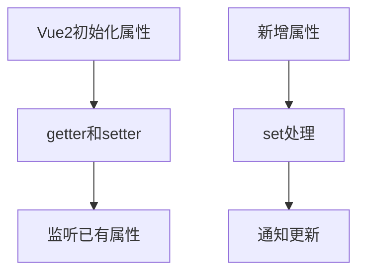

# Vue 2 响应式限制与 $set

> 课程范围：P117 至最后（用户指定）。未取得视频逐集标题与字幕，本篇为自主编写的知识体系笔记，不代表逐集内容已核验。
> 示例版本：Vue 2.7.16（仅用于旧课程对照）；版本固定用于复现，不表示最新版本。

## 学习目标与使用场景

准确识别 Vue 2 新增对象属性和数组下标赋值的更新限制，并与 Vue 3 对照。

## 先把原理讲清楚

Vue 2 主要基于 Object.defineProperty 对已有属性建立 getter/setter。初始化时没有被处理的普通对象新属性，不会自动拥有相同拦截能力。直接写 user.age = 20，JavaScript 对象确实有了 age，但界面不一定因这一步自动更新。

Vue.set 或实例 $set 能为对象新增响应式属性。更简单的方式是提前在 data 声明所有已知字段，或者替换成包含完整字段的新对象。不要为每个普通赋值都使用 $set，它主要解决已有观测机制覆盖不到的变化。

数组的某些变更方法在 Vue 2 中经过处理，例如 push 和 splice；直接 items[index] = value 或修改 length 不会自动触发同样的更新。可用 splice 替换元素，或使用 $set。Vue 3 基于 Proxy，能处理这些常见新增和下标变化，但也不能追踪所有任意外部变量。

演示响应式限制时要避免另一个状态变化“顺便触发重新渲染”，让非响应式新字段看起来正常。例如先直接添加 age，再点另一个响应式按钮，界面可能显示已添加 age，这不能证明第一次修改本身触发了更新。

## 运行方式

直接打开同目录下的 [配套演示](示例/15-Vue2响应式限制与set.html)。运行库放在示例/vendor，已本地保存，普通示例不需要联网。Obsidian 的代码块用于阅读，不会自动执行 HTML。也可以把下面整段内容保存到示例目录中的新 HTML 文件；改变位置时需要相应调整运行库相对路径。

## 完整代码演示

```html
<!doctype html>
<html lang="zh-CN">
<head>
<meta charset="UTF-8">
<meta name="viewport" content="width=device-width, initial-scale=1">
<title>Vue 2 响应式限制与 $set</title>
<style>
body{font-family:system-ui,sans-serif;line-height:1.7;margin:2rem auto;padding:0 1rem;max-width:58rem;color:#202124;background:#fff}button,input,select{font:inherit;padding:.4rem;margin:.3rem}button{cursor:pointer}label{display:inline-block;margin:.3rem}section{border:1px solid #aaa;padding:1rem;margin:1rem 0}li{margin:.4rem 0}pre{white-space:pre-wrap;overflow-wrap:anywhere}button:focus-visible,a:focus-visible,input:focus-visible,select:focus-visible{outline:3px solid #b45309}.active{background:#166534;color:#fff}nav{display:flex;gap:1rem;flex-wrap:wrap}
</style>
</head>
<body>
<div id="app">
<h1>Vue 2 响应式新增</h1><p>用户：{{ user.name }}；年龄：{{ user.age === undefined ? '未填写' : user.age }}</p><button @click="addAge">响应式添加年龄</button><ul><li v-for="(item,index) in items" :key="index">{{ item }}</li></ul><button @click="replace">替换第一项</button>
</div>
<script src="./vendor/vue-2.7.16.js"></script>
<script>
new Vue({
  el:'#app',
  data(){return {user:{name:'小明'},items:['HTML','CSS']};},
  methods:{
    addAge(){this.$set(this.user,'age',20);},
    replace(){this.items.splice(0,1,'Vue');}
  }
});
</script>
</body>
</html>
```

## 按执行顺序解释

1. 初始 user 没有 age，模板用 undefined 判断提供可见占位。
2. addAge 通过 $set 新增属性并通知依赖更新。
3. splice(0,1,"Vue") 从索引 0 开始删除一项并插入 Vue。
4. 例子中 key 使用下标只用于固定且不含内部状态的演示；真实可变列表仍应使用业务 ID。

## 预期结果与验证步骤

点击添加年龄后立即显示 20；点击替换后第一项从 HTML 变为 Vue。

操作时同时打开浏览器开发者工具：Elements 查看模板生成的节点，Console 查看是否有语法错误或 Vue 警告。若页面显示双大括号原文，优先检查运行库路径、脚本加载顺序和挂载目标。

## 图解



## 注意事项与易错点

- 不要先直接添加 age 再调用 $set 期待一定补救已经遗漏的观测；应从一开始就正确新增。
- Vue 3 不再需要 $set，迁移时不要机械保留这个 API。
- 优先完整声明业务字段，减少运行中动态扩展数据形状。

## 动手练习

用替换整个 user 对象的方式新增 city 字段。

<details>
<summary>参考答案与思路（先自己尝试）</summary>

```js
this.user = { ...this.user, city:'上海' };
// 同时在模板展示 {{ user.city || '未知城市' }}
```

练习片段需要放入本篇已有的模板或 setup 对应位置，不是另一份独立文件。修改后重做上面的验证步骤，并检查空值、重复操作和恢复状态。

</details>

## 复习问题

1. 本篇中哪些数据是真正的源状态，哪些是推导结果或 DOM 表示？
2. 如果页面没有按预期更新，应该先检查运行环境、API 版本还是依赖关系？结合示例说明。
3. 能否不用背代码，用自己的话描述图中每一步的输入和输出？


## 相关笔记

[[前端/VUE/14-Vue2与OptionsAPI完整示例|上一篇：Vue 2 与 Options API 完整示例]] · [[前端/VUE/16-VueRouter路由基础|下一篇：Vue Router 路由基础]] · [[前端/VUE/00-Vue学习索引]]

## 官方参考与来源边界

- [Vue 3 中文指南](https://cn.vuejs.org/guide/introduction.html)
- [Vue 2 中文指南](https://v2.cn.vuejs.org/v2/guide/)
- [Vue 2 维护结束说明](https://v2.vuejs.org/eol/)

以上文档用于核对 API 和版本差异；课程链接与集数只来自用户指定范围，未据此编造每集标题或台词。
