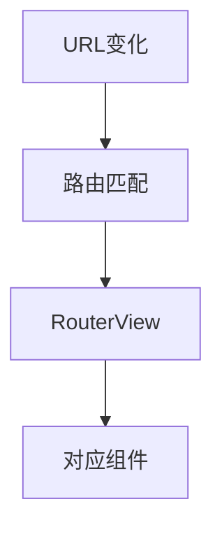

# Vue Router 路由基础

> 课程范围：P117 至最后（用户指定）。未取得视频逐集标题与字幕，本篇为自主编写的知识体系笔记，不代表逐集内容已核验。
> 示例版本：Vue 3.5.13；版本固定用于复现，不表示最新版本。

## 学习目标与使用场景

理解单页应用路由，并在无需服务器回退配置的 hash 模式中运行示例。

## 先把原理讲清楚

前端路由把 URL 与组件对应起来。点击导航时，路由器更新当前地址和展示组件，通常不会重新请求整份 HTML。RouterLink 负责导航，RouterView 是当前路由组件显示的位置，这两个名字表达的是不同职责。

Vue Router 4 面向 Vue 3，使用 createRouter；Vue Router 3 面向 Vue 2，初始化方式不同。本示例明确采用 Vue 3 与 Router 4。不能复制 Vue 2 的 new VueRouter 并直接放进 Vue 3 应用。

hash 模式把路径放在 # 后面，例如 #/about，适合双击 HTML 的学习演示。history 模式的 URL 更自然，但部署服务器必须把应用路由回退到入口 HTML，否则刷新子路径可能返回 404。这个问题不由 Vue 模板语法解决。

路由参数来自 URL，应当按外部输入处理。读取参数时注意类型通常是字符串，且用户可以随意修改。导航守卫可改善前端流程，但后端权限验证不能依赖前端路由是否允许进入页面。

## 运行方式

直接打开同目录下的 [配套演示](示例/16-VueRouter路由基础.html)。运行库放在示例/vendor，已本地保存，普通示例不需要联网。Obsidian 的代码块用于阅读，不会自动执行 HTML。也可以把下面整段内容保存到示例目录中的新 HTML 文件；改变位置时需要相应调整运行库相对路径。

## 完整代码演示

```html
<!doctype html>
<html lang="zh-CN">
<head>
<meta charset="UTF-8">
<meta name="viewport" content="width=device-width, initial-scale=1">
<title>Vue Router 路由基础</title>
<style>
body{font-family:system-ui,sans-serif;line-height:1.7;margin:2rem auto;padding:0 1rem;max-width:58rem;color:#202124;background:#fff}button,input,select{font:inherit;padding:.4rem;margin:.3rem}button{cursor:pointer}label{display:inline-block;margin:.3rem}section{border:1px solid #aaa;padding:1rem;margin:1rem 0}li{margin:.4rem 0}pre{white-space:pre-wrap;overflow-wrap:anywhere}button:focus-visible,a:focus-visible,input:focus-visible,select:focus-visible{outline:3px solid #b45309}.active{background:#166534;color:#fff}nav{display:flex;gap:1rem;flex-wrap:wrap}
</style>
</head>
<body>
<div id="app">
<h1>路由演示</h1><nav><router-link to="/">首页</router-link> · <router-link to="/about">关于</router-link></nav><router-view></router-view>
</div>
<script src="./vendor/vue-3.5.13.js"></script>
<script src="./vendor/vue-router-4.5.0.js"></script>
<script>
const {createApp} = Vue;
const Home = {template:'<h2>首页内容</h2>'};
const About = {template:'<h2>关于内容</h2>'};
const router = VueRouter.createRouter({
  history: VueRouter.createWebHashHistory(),
  routes:[{path:'/',component:Home},{path:'/about',component:About}]
});
createApp({}).use(router).mount('#app');
</script>
</body>
</html>
```

## 按执行顺序解释

1. 本页除了 Vue 运行库，还加载本地 Vue Router 4 运行库。
2. routes 数组声明路径与组件的映射，RouterView 根据当前匹配结果显示对应组件。
3. use(router) 安装路由插件并提供组件与路由状态。
4. 点击关于后地址出现 #/about，刷新仍能找到同一个本地 HTML 文件。

## 预期结果与验证步骤

点击首页或关于，只有路由内容切换，地址的 hash 随之改变。

操作时同时打开浏览器开发者工具：Elements 查看模板生成的节点，Console 查看是否有语法错误或 Vue 警告。若页面显示双大括号原文，优先检查运行库路径、脚本加载顺序和挂载目标。

## 图解



## 注意事项与易错点

- 路由组件内 useRoute/useRouter 需要路由上下文，不能在任意全局位置随意调用。
- hash 演示可以本地打开；history 部署必须正确配置服务端回退。
- 路由参数不等于可信业务数据，敏感资源仍须后端鉴权。

## 动手练习

添加 /notes 页面，导航栏增加笔记链接。

<details>
<summary>参考答案与思路（先自己尝试）</summary>

```js
// routes 增加 {path:'/notes',component:{template:'<h2>学习笔记</h2>'}}
// <router-link to="/notes">笔记</router-link>
```

练习片段需要放入本篇已有的模板或 setup 对应位置，不是另一份独立文件。修改后重做上面的验证步骤，并检查空值、重复操作和恢复状态。

</details>

## 复习问题

1. 本篇中哪些数据是真正的源状态，哪些是推导结果或 DOM 表示？
2. 如果页面没有按预期更新，应该先检查运行环境、API 版本还是依赖关系？结合示例说明。
3. 能否不用背代码，用自己的话描述图中每一步的输入和输出？


## 相关笔记

[[前端/VUE/15-Vue2响应式限制与set|上一篇：Vue 2 响应式限制与 $set]] · [[前端/VUE/17-共享状态与provide-inject|下一篇：共享状态与 provide/inject]] · [[前端/VUE/00-Vue学习索引]]

## 官方参考与来源边界

- [Vue 3 中文指南](https://cn.vuejs.org/guide/introduction.html)
- [Vue 2 中文指南](https://v2.cn.vuejs.org/v2/guide/)
- [Vue 2 维护结束说明](https://v2.vuejs.org/eol/)
- [Vue Router 指南](https://router.vuejs.org/zh/guide/)

以上文档用于核对 API 和版本差异；课程链接与集数只来自用户指定范围，未据此编造每集标题或台词。
