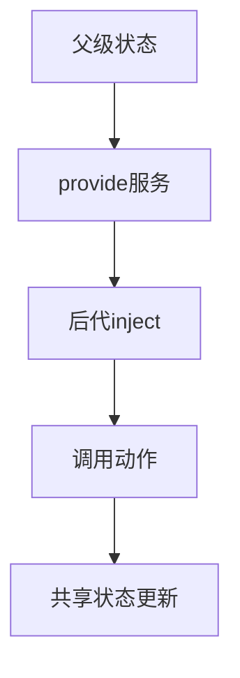

# 共享状态与 provide/inject

> 课程范围：P117 至最后（用户指定）。未取得视频逐集标题与字幕，本篇为自主编写的知识体系笔记，不代表逐集内容已核验。
> 示例版本：Vue 3.5.13；版本固定用于复现，不表示最新版本。

## 学习目标与使用场景

理解状态归属、深层依赖传递和状态管理库的适用边界。

## 先把原理讲清楚

组件各自拥有状态是最简单的起点。当兄弟组件要协作，通常把状态提升到共同父组件，再通过 props 和事件协调。不要因为学习了状态管理就把所有输入框、开关和临时弹窗状态都放到全局。

当相隔很远的后代都需要同一份服务或状态时，可以使用 provide/inject，避免每一层都转发相同 props。它是依赖注入机制，仍然需要明确谁拥有状态、谁能修改。提供 readonly 状态和明确的动作函数，可以集中约束修改入口。

共享状态若放在模块顶层，所有导入它的组件都会使用同一份实例。这在单页应用中可能正合需求，在服务端渲染中则要注意请求隔离，不能把不同用户数据写入共享单例。状态管理工具不能自动修复错误的生命周期设计。

大型项目可以使用 Pinia 组织 store、派生状态和动作，并获得开发工具支持。本篇先用原生 Vue 展示共享机制，目的是理解数据流；这不是 Pinia API 演示。读到 defineStore、storeToRefs 时，应另外查阅 Pinia 文档，不要把它们当成 Vue 自带方法。

## 运行方式

直接打开同目录下的 [配套演示](示例/17-共享状态与provide-inject.html)。运行库放在示例/vendor，已本地保存，普通示例不需要联网。Obsidian 的代码块用于阅读，不会自动执行 HTML。也可以把下面整段内容保存到示例目录中的新 HTML 文件；改变位置时需要相应调整运行库相对路径。

## 完整代码演示

```html
<!doctype html>
<html lang="zh-CN">
<head>
<meta charset="UTF-8">
<meta name="viewport" content="width=device-width, initial-scale=1">
<title>共享状态与 provide/inject</title>
<style>
body{font-family:system-ui,sans-serif;line-height:1.7;margin:2rem auto;padding:0 1rem;max-width:58rem;color:#202124;background:#fff}button,input,select{font:inherit;padding:.4rem;margin:.3rem}button{cursor:pointer}label{display:inline-block;margin:.3rem}section{border:1px solid #aaa;padding:1rem;margin:1rem 0}li{margin:.4rem 0}pre{white-space:pre-wrap;overflow-wrap:anywhere}button:focus-visible,a:focus-visible,input:focus-visible,select:focus-visible{outline:3px solid #b45309}.active{background:#166534;color:#fff}nav{display:flex;gap:1rem;flex-wrap:wrap}
</style>
</head>
<body>
<div id="app">
<h1>共享主题</h1><theme-switch></theme-switch><theme-status></theme-status>
</div>
<script src="./vendor/vue-3.5.13.js"></script>
<script>
const {createApp, ref, readonly, provide, inject} = Vue;
const ThemeSwitch = {setup(){return inject('themeService');},template:'<button @click="toggle">切换主题</button>'};
const ThemeStatus = {setup(){return inject('themeService');},template:'<p>当前主题：{{ theme }}</p>'};
createApp({components:{ThemeSwitch,ThemeStatus},setup(){
  const theme = ref('light');
  function toggle(){theme.value = theme.value === 'light' ? 'dark' : 'light';}
  provide('themeService',{theme:readonly(theme),toggle});
  return {};
}}).mount('#app');
</script>
</body>
</html>
```

## 按执行顺序解释

1. 根组件提供一个服务对象，包含只读主题与 toggle 动作。
2. 两个后代通过相同 key 注入服务，读取的是同一份主题状态。
3. 子组件只调用 toggle，不直接修改 readonly ref。
4. 生产项目可用 Symbol 作为注入 key，减少字符串冲突，并约定缺失注入时的行为。

## 预期结果与验证步骤

点击切换按钮，另一个组件中的主题在 light 和 dark 之间切换，体现跨组件共享。

操作时同时打开浏览器开发者工具：Elements 查看模板生成的节点，Console 查看是否有语法错误或 Vue 警告。若页面显示双大括号原文，优先检查运行库路径、脚本加载顺序和挂载目标。

## 图解



## 注意事项与易错点

- Vue 2 Options API provide 普通值不自动具有 Vue 3 ref 一样的响应式行为，不能机械照搬。
- 不要把密码或敏感令牌当普通可持久化前端共享状态随意暴露。
- 跨页面共享状态和持久化是两回事，刷新后是否保留需要单独设计。

## 动手练习

增加 reset 动作，让任意后代可以恢复 light。

<details>
<summary>参考答案与思路（先自己尝试）</summary>

```js
// 提供的对象增加 reset: () => { theme.value = 'light'; }
// 子组件注入后通过 <button @click="reset">恢复</button> 调用。
```

练习片段需要放入本篇已有的模板或 setup 对应位置，不是另一份独立文件。修改后重做上面的验证步骤，并检查空值、重复操作和恢复状态。

</details>

## 复习问题

1. 本篇中哪些数据是真正的源状态，哪些是推导结果或 DOM 表示？
2. 如果页面没有按预期更新，应该先检查运行环境、API 版本还是依赖关系？结合示例说明。
3. 能否不用背代码，用自己的话描述图中每一步的输入和输出？


## 相关笔记

[[前端/VUE/16-VueRouter路由基础|上一篇：Vue Router 路由基础]] · [[前端/VUE/18-异步请求与界面状态|下一篇：异步请求与界面状态]] · [[前端/VUE/00-Vue学习索引]]

## 官方参考与来源边界

- [Vue 3 中文指南](https://cn.vuejs.org/guide/introduction.html)
- [Vue 2 中文指南](https://v2.cn.vuejs.org/v2/guide/)
- [Vue 2 维护结束说明](https://v2.vuejs.org/eol/)
- [Pinia 指南](https://pinia.vuejs.org/zh/introduction.html)

以上文档用于核对 API 和版本差异；课程链接与集数只来自用户指定范围，未据此编造每集标题或台词。
