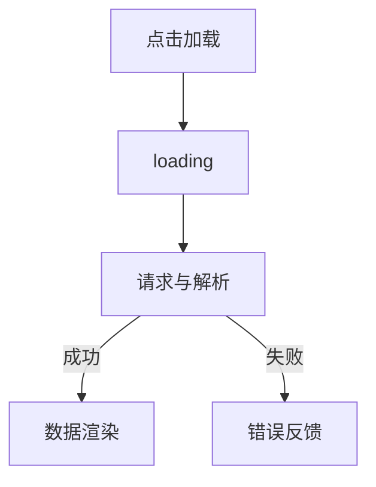

# 异步请求与界面状态

> 课程范围：P117 至最后（用户指定）。未取得视频逐集标题与字幕，本篇为自主编写的知识体系笔记，不代表逐集内容已核验。
> 示例版本：Vue 3.5.13；版本固定用于复现，不表示最新版本。

## 学习目标与使用场景

同时处理加载、成功、失败和卸载取消，避免只写一个 fetch 的半成品交互。

## 先把原理讲清楚

真实页面不是只有“拿到数据”这一种状态。用户点击后需要知道是否正在加载；网络或解析失败后需要能理解错误并重试；数据为空时也要有明确反馈。把这些状态显式建模，比依赖某个数组是否为空更可靠。

fetch 只会在网络错误、取消等情况下拒绝 Promise，HTTP 404/500 通常仍会得到 Response，所以必须检查 response.ok。随后 response.json 还可能因为内容格式错误而失败。错误处理要覆盖完整请求链。

组件卸载或用户重新发起请求时，可以用 AbortController 取消旧请求；即使服务器最终继续处理，也能阻止前端继续等待已无意义的结果。多个请求并发时还应避免旧响应覆盖新状态，可用请求编号或统一取消策略。

示例使用 data URL 返回固定 JSON，不依赖不存在的 /api 地址，方便离线演示“加载到渲染”的流程；同时提供模拟失败按钮。真实接口替换 URL 后还要考虑 CORS、鉴权、服务端校验和实际延迟，离线成功不证明真实后端可用。

## 运行方式

直接打开同目录下的 [配套演示](示例/18-异步请求与界面状态.html)。运行库放在示例/vendor，已本地保存，普通示例不需要联网。Obsidian 的代码块用于阅读，不会自动执行 HTML。也可以把下面整段内容保存到示例目录中的新 HTML 文件；改变位置时需要相应调整运行库相对路径。

## 完整代码演示

```html
<!doctype html>
<html lang="zh-CN">
<head>
<meta charset="UTF-8">
<meta name="viewport" content="width=device-width, initial-scale=1">
<title>异步请求与界面状态</title>
<style>
body{font-family:system-ui,sans-serif;line-height:1.7;margin:2rem auto;padding:0 1rem;max-width:58rem;color:#202124;background:#fff}button,input,select{font:inherit;padding:.4rem;margin:.3rem}button{cursor:pointer}label{display:inline-block;margin:.3rem}section{border:1px solid #aaa;padding:1rem;margin:1rem 0}li{margin:.4rem 0}pre{white-space:pre-wrap;overflow-wrap:anywhere}button:focus-visible,a:focus-visible,input:focus-visible,select:focus-visible{outline:3px solid #b45309}.active{background:#166534;color:#fff}nav{display:flex;gap:1rem;flex-wrap:wrap}
</style>
</head>
<body>
<div id="app">
<h1>异步课程列表</h1><button @click="load(false)" :disabled="loading">加载</button><button @click="load(true)" :disabled="loading">模拟失败</button><p v-if="loading" role="status">加载中</p><p v-else-if="error" role="alert">{{ error }}</p><ul v-else><li v-for="item in items" :key="item.id">{{ item.title }}</li></ul>
</div>
<script src="./vendor/vue-3.5.13.js"></script>
<script>
const {createApp, ref, onUnmounted} = Vue;
createApp({setup(){
  const items = ref([]), loading = ref(false), error = ref(''); let controller;
  async function load(fail){
    controller?.abort(); controller = new AbortController();
    loading.value = true; error.value = '';
    try {
      if(fail) throw new Error('模拟：服务暂不可用');
      const url = 'data:application/json,' + encodeURIComponent(JSON.stringify([{id:1,title:'Vue 学习清单'}]));
      const response = await fetch(url,{signal:controller.signal});
      if(!response.ok) throw new Error('HTTP ' + response.status);
      items.value = await response.json();
    } catch(e) {if(e.name !== 'AbortError') error.value = e.message;}
    finally {loading.value = false;}
  }
  onUnmounted(() => controller?.abort());
  return {items,loading,error,load};
}}).mount('#app');
</script>
</body>
</html>
```

## 按执行顺序解释

1. loading 控制按钮禁用，避免正常 UI 操作触发并发加载。
2. error 在每次加载前清空，使重试可以恢复正常流程。
3. 固定 JSON 编码进 data URL，fetch 和 JSON 解析仍走异步链。
4. 卸载钩子取消请求，catch 过滤 AbortError；这个禁用按钮的示例不用于演示并发搜索竞态。

## 预期结果与验证步骤

点击加载后出现“Vue 学习清单”；点击模拟失败显示错误提示；再次加载能恢复成功。

操作时同时打开浏览器开发者工具：Elements 查看模板生成的节点，Console 查看是否有语法错误或 Vue 警告。若页面显示双大括号原文，优先检查运行库路径、脚本加载顺序和挂载目标。

## 图解



## 注意事项与易错点

- 不要把用户输入直接当作 v-html 展示错误信息，插值会按文本显示。
- 请求带凭据和跨域策略必须根据后端设计配置，不能靠随意添加 mode:no-cors 解决。
- 如果改为允许并发请求，须加入请求编号，防止旧 finally 提前清掉新请求 loading。

## 动手练习

为成功但空数组的响应增加“暂无课程”提示。

<details>
<summary>参考答案与思路（先自己尝试）</summary>

```js
<p v-else-if="items.length === 0">暂无课程</p>
<!-- 放在错误分支之后、列表分支之前；需要额外 loaded 状态区分尚未请求。 -->
```

练习片段需要放入本篇已有的模板或 setup 对应位置，不是另一份独立文件。修改后重做上面的验证步骤，并检查空值、重复操作和恢复状态。

</details>

## 复习问题

1. 本篇中哪些数据是真正的源状态，哪些是推导结果或 DOM 表示？
2. 如果页面没有按预期更新，应该先检查运行环境、API 版本还是依赖关系？结合示例说明。
3. 能否不用背代码，用自己的话描述图中每一步的输入和输出？


## 相关笔记

[[前端/VUE/17-共享状态与provide-inject|上一篇：共享状态与 provide/inject]] · [[前端/VUE/19-SFC与Vite项目结构|下一篇：SFC 与 Vite 项目结构]] · [[前端/VUE/00-Vue学习索引]]

## 官方参考与来源边界

- [Vue 3 中文指南](https://cn.vuejs.org/guide/introduction.html)
- [Vue 2 中文指南](https://v2.cn.vuejs.org/v2/guide/)
- [Vue 2 维护结束说明](https://v2.vuejs.org/eol/)

以上文档用于核对 API 和版本差异；课程链接与集数只来自用户指定范围，未据此编造每集标题或台词。
