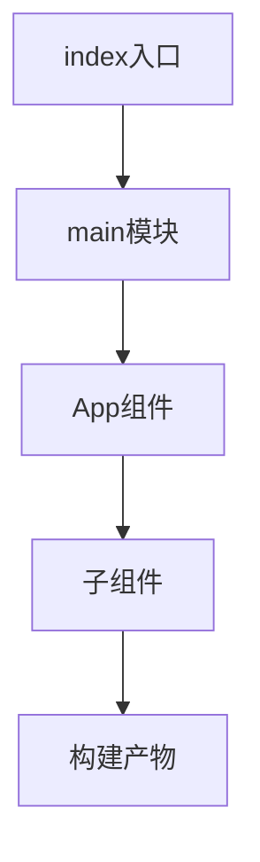

# SFC 与 Vite 项目结构

> **当前主线**：用户指定的 Vue3＋TS 71 集课程；本篇为主题对照与自主讲解，旧 Vue2 演示保留为迁移参考。
> 示例版本：Vue 3.5.13；版本固定用于复现，不表示最新版本。

---

<span style="background-color:rgb(255, 249, 227)">一：学习目标与使用场景</span>

从可直接打开的演示过渡到 .vue 单文件组件，并分清浏览器运行与构建编译。

---

<span style="background-color:rgb(255, 249, 227)">二：先把原理讲清楚</span>

单文件组件 SFC 把 template、script 和 style 写进 .vue 文件，构建工具把它们转换成浏览器能运行的 JavaScript 和 CSS。浏览器不能直接像 HTML 一样双击理解一个 .vue 文件，因此运行方式必须与前面的 CDN 示例区分。

Vite 是开发服务器和构建工具，Vue 插件负责编译 SFC。常见入口是 index.html 加载 src/main.js，main.js 创建 Vue 应用并挂载 App.vue。组件进一步通过 import 连接，而不是把所有代码放到一个全局脚本。

script setup 是编译时语法糖，顶层变量和导入可以被模板直接使用，defineProps、defineEmits 是编译宏，不是必须从 Vue 导入的普通函数。它们依赖 SFC 编译环境，不能复制到无构建全局脚本里直接执行。

scoped 样式通过编译生成的属性选择器限定作用范围，不等于真正的 Shadow DOM。全局布局、字体和重置样式仍要集中管理。开发服务器能正常打开也不代表部署配置已经正确，构建产物还要检查资源基础路径与路由回退。

---

<span style="background-color:rgb(255, 249, 227)">三：运行方式</span>

直接打开同目录下的 [配套演示](示例/19-SFC与Vite项目结构.html)。运行库放在示例/vendor，已本地保存，普通示例不需要联网。Obsidian 的代码块用于阅读，不会自动执行 HTML。也可以把下面整段内容保存到示例目录中的新 HTML 文件；改变位置时需要相应调整运行库相对路径。

---

<span style="background-color:rgb(255, 249, 227)">四：完整代码演示</span>

```html
<!doctype html>
<html lang="zh-CN">
<head>
<meta charset="UTF-8">
<meta name="viewport" content="width=device-width, initial-scale=1">
<title>SFC 与 Vite 项目结构</title>
<style>
body{font-family:system-ui,sans-serif;line-height:1.7;margin:2rem auto;padding:0 1rem;max-width:58rem;color:#202124;background:#fff}button,input,select{font:inherit;padding:.4rem;margin:.3rem}button{cursor:pointer}label{display:inline-block;margin:.3rem}section{border:1px solid #aaa;padding:1rem;margin:1rem 0}li{margin:.4rem 0}pre{white-space:pre-wrap;overflow-wrap:anywhere}button:focus-visible,a:focus-visible,input:focus-visible,select:focus-visible{outline:3px solid #b45309}.active{background:#166534;color:#fff}nav{display:flex;gap:1rem;flex-wrap:wrap}
</style>
</head>
<body>
<div id="app">
<h1>SFC 对应效果</h1><p>{{ message }}</p><button @click="count++">已点击 {{ count }} 次</button>
</div>
<script src="./vendor/vue-3.5.13.js"></script>
<script>
const {createApp, ref} = Vue;
createApp({setup(){const count=ref(0);return {count,message:'这个 HTML 展示下方 App.vue 的等价效果'};}}).mount('#app');
</script>
</body>
</html>
```

---

<span style="background-color:rgb(255, 249, 227)">五：按执行顺序解释</span>

1. 本页配套 HTML 仍是可直接打开的等价演示，真正 SFC 代码在下方。
2. 先通过官方项目脚手架选择 Vue 的 JavaScript 起步配置，按提示安装依赖。
3. 把 App.vue 替换为下方组件后，使用项目提供的 dev 命令启动。
4. 生产发布先执行 build，再用 preview 或实际静态服务器检验 dist；不要把开发服务器当生产服务。

---

<span style="background-color:rgb(255, 249, 227)">六：预期结果与验证步骤</span>

本地 HTML 点击后递增数字；放入 Vite 项目的 App.vue 也会产生相同交互，但源码组织与运行环境不同。

操作时同时打开浏览器开发者工具：Elements 查看模板生成的节点，Console 查看是否有语法错误或 Vue 警告。若页面显示双大括号原文，优先检查运行库路径、脚本加载顺序和挂载目标。

---

<span style="background-color:rgb(255, 249, 227)">七：图解</span>



---

<span style="background-color:rgb(255, 249, 227)">八：注意事项与易错点</span>

- Node.js 版本要求应以安装时脚手架提示与当前官方文档为准，不把某个旧教程版本当永久要求。
- defineProps 等宏只能在支持的编译位置使用。
- SFC 中导入路径是相对当前文件，大小写在不同操作系统可能导致差异。

---

<span style="background-color:rgb(255, 249, 227)">九：动手练习</span>

把计数按钮拆成 Counter.vue，再在 App.vue 导入使用。

<details>
<summary>参考答案与思路（先自己尝试）</summary>

```js
<!-- App.vue -->
<script setup>
import Counter from './Counter.vue';
</script>
<template><Counter /></template>
<!-- Counter.vue 内使用本篇的 ref 与按钮模板即可。 -->
```

练习片段需要放入本篇已有的模板或 setup 对应位置，不是另一份独立文件。修改后重做上面的验证步骤，并检查空值、重复操作和恢复状态。

</details>

---

<span style="background-color:rgb(255, 249, 227)">十：复习问题</span>

1. 本篇中哪些数据是真正的源状态，哪些是推导结果或 DOM 表示？
2. 如果页面没有按预期更新，应该先检查运行环境、API 版本还是依赖关系？结合示例说明。
3. 能否不用背代码，用自己的话描述图中每一步的输入和输出？

### App.vue 完整内容

```vue
<script setup>
import { ref } from 'vue';
const count = ref(0);
</script>
<template>
  <h1>Vue SFC 计数器</h1>
  <button @click="count++">已点击 {{ count }} 次</button>
</template>
<style scoped>
button { padding: 0.6rem 1rem; }
</style>
```

### 创建项目时的操作

在终端中运行官方脚手架 `npm create vue@latest`，按提示创建项目；进入生成目录，执行 `npm install` 和 `npm run dev`。这里的 latest 会随时间变化，应阅读工具给出的 Node 版本要求。

---

<span style="background-color:rgb(255, 249, 227)">十一：相关笔记</span>

[[前端/VUE/18-异步请求与界面状态|上一篇：异步请求与界面状态]] · [[前端/VUE/20-动态组件KeepAlive与Transition|下一篇：动态组件、KeepAlive 与 Transition]] · [[前端/VUE/00-Vue学习索引]]

---

<span style="background-color:rgb(255, 249, 227)">十二：官方参考与来源边界</span>

- [Vue 3 中文指南](https://cn.vuejs.org/guide/introduction.html)
- [Vue 2 中文指南](https://v2.cn.vuejs.org/v2/guide/)
- [Vue 2 维护结束说明](https://v2.vuejs.org/eol/)

原有示例和参考继续保留；当前课程目录已另行核验。没有取得字幕，不将自主讲解声称为视频逐字内容。

---

<span style="background-color:rgb(255, 249, 227)">专题深化：SFC、编译宏与类型检查各司其职</span>

`.vue` 文件由模板、脚本和样式组成，需要 SFC 编译器；不是浏览器直接理解的单文件 HTML。`<script setup lang="ts">` 中的顶层绑定可供模板使用，宏会在构建阶段转换。

Vite 提供开发和构建流水线，Vue 插件处理 SFC；Vue 模板的类型检查用 vue-tsc。Vite 能跑起来并不说明所有 TS 和模板类型都正确。

路径别名需要构建工具与类型检查器同步理解。本目录新建的 vue3-ts-demo 保持相对导入，先掌握模块关系后再加别名，减少初学时同时排查多个配置层。

- [指定课程 P3—P4、P10](https://www.bilibili.com/video/BV1Za4y1r7KE/?p=3)
- [[前端/VUE/00-课程目录与来源说明|已核验的完整分集目录与来源边界]]
- [Vue 官方指南](https://vuejs.org/guide/introduction.html)
- [Vue 与 TypeScript](https://vuejs.org/guide/typescript/composition-api.html)
