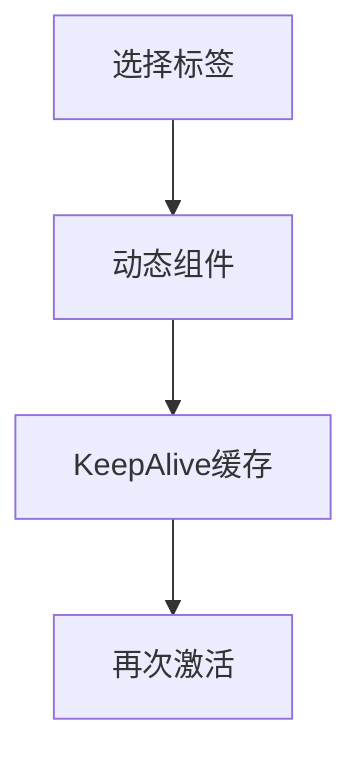

# 动态组件、KeepAlive 与 Transition

> **当前主线**：用户指定的 Vue3＋TS 71 集课程；本篇为主题对照与自主讲解，旧 Vue2 演示保留为迁移参考。
> 示例版本：Vue 3.5.13；版本固定用于复现，不表示最新版本。

---

<span style="background-color:rgb(255, 249, 227)">一：学习目标与使用场景</span>

理解组件切换、状态缓存和进入离开动画是三种独立能力。

---

<span style="background-color:rgb(255, 249, 227)">二：先把原理讲清楚</span>

component 的 is 属性决定当前渲染哪个组件。它适合标签页、步骤页和相互排斥的面板。默认情况下，切换到另一组件会卸载原组件，再切换回来会重新创建，因此内部状态可能重置。

KeepAlive 缓存组件实例，切走时变为停用，再切回来会激活。缓存状态不等于内容持久化：刷新浏览器后依然会丢失。缓存组件的生命周期还包括 activated 与 deactivated，需要暂停后台计时器等资源时不能只依赖 unmounted。

Transition 负责单个元素或组件切换时的 CSS 过渡钩子，与缓存没有必然关系。列表增删动画则使用 TransitionGroup。动画应让状态变化更清楚，避免延迟用户操作，并尊重 prefers-reduced-motion。

三种能力可以组合，但调试时应分开验证：先确认组件切换正确，再确认状态是否需要缓存，最后再添加动画。这样出现问题时可以准确定位是生命周期、身份 key 还是 CSS 钩子导致。

---

<span style="background-color:rgb(255, 249, 227)">三：运行方式</span>

直接打开同目录下的 [配套演示](示例/20-动态组件KeepAlive与Transition.html)。运行库放在示例/vendor，已本地保存，普通示例不需要联网。Obsidian 的代码块用于阅读，不会自动执行 HTML。也可以把下面整段内容保存到示例目录中的新 HTML 文件；改变位置时需要相应调整运行库相对路径。

---

<span style="background-color:rgb(255, 249, 227)">四：完整代码演示</span>

```html
<!doctype html>
<html lang="zh-CN">
<head>
<meta charset="UTF-8">
<meta name="viewport" content="width=device-width, initial-scale=1">
<title>动态组件、KeepAlive 与 Transition</title>
<style>
body{font-family:system-ui,sans-serif;line-height:1.7;margin:2rem auto;padding:0 1rem;max-width:58rem;color:#202124;background:#fff}button,input,select{font:inherit;padding:.4rem;margin:.3rem}button{cursor:pointer}label{display:inline-block;margin:.3rem}section{border:1px solid #aaa;padding:1rem;margin:1rem 0}li{margin:.4rem 0}pre{white-space:pre-wrap;overflow-wrap:anywhere}button:focus-visible,a:focus-visible,input:focus-visible,select:focus-visible{outline:3px solid #b45309}.active{background:#166534;color:#fff}nav{display:flex;gap:1rem;flex-wrap:wrap}
</style>
</head>
<body>
<div id="app">
<h1>缓存标签页</h1><button @click="current = 'Editor'">编辑</button><button @click="current = 'Preview'">预览</button><keep-alive><component :is="current"></component></keep-alive>
</div>
<script src="./vendor/vue-3.5.13.js"></script>
<script>
const {createApp, ref} = Vue;
const Editor={name:'Editor',setup(){return {text:ref('草稿')};},template:'<section><h2>编辑器</h2><input v-model="text" aria-label="草稿"></section>'};
const Preview={name:'Preview',template:'<p>预览面板：切回编辑器检查草稿是否保留。</p>'};
createApp({components:{Editor,Preview},setup(){return {current:ref('Editor')};}}).mount('#app');
</script>
</body>
</html>
```

---

<span style="background-color:rgb(255, 249, 227)">五：按执行顺序解释</span>

1. current 存放注册过的组件名称，is 根据名称找到组件定义。
2. Editor 内部的 text 属于它自己的实例状态。
3. KeepAlive 包住动态组件，切换时保留 Editor 实例，因此草稿不丢失。
4. 删除 KeepAlive 再试一次，可以直接观察重新创建实例的差异。

---

<span style="background-color:rgb(255, 249, 227)">六：预期结果与验证步骤</span>

修改草稿后切到预览，再切回编辑，输入框仍保留刚才的文本。刷新页面后回到初始草稿。

操作时同时打开浏览器开发者工具：Elements 查看模板生成的节点，Console 查看是否有语法错误或 Vue 警告。若页面显示双大括号原文，优先检查运行库路径、脚本加载顺序和挂载目标。

---

<span style="background-color:rgb(255, 249, 227)">七：图解</span>



---

<span style="background-color:rgb(255, 249, 227)">八：注意事项与易错点</span>

- 缓存过多实例会占用内存，可使用 max 或 include/exclude 控制。
- Transition 需要匹配过渡类，例如 fade-enter-active；只有包一层标签不会凭空产生动画。
- 缓存组件离开时不一定卸载，后台任务可能需要在 deactivated 停止。

---

<span style="background-color:rgb(255, 249, 227)">九：动手练习</span>

用 Transition 给一个 v-if 提示加淡入淡出，并支持减少动画偏好。

<details>
<summary>参考答案与思路（先自己尝试）</summary>

```js
<!-- <transition name="fade"><p v-if="open">提示</p></transition> -->
/* .fade-enter-active,.fade-leave-active { transition:opacity .2s; }
.fade-enter-from,.fade-leave-to { opacity:0; }
@media(prefers-reduced-motion:reduce){.fade-enter-active,.fade-leave-active{transition:none;}} */
```

练习片段需要放入本篇已有的模板或 setup 对应位置，不是另一份独立文件。修改后重做上面的验证步骤，并检查空值、重复操作和恢复状态。

</details>

---

<span style="background-color:rgb(255, 249, 227)">十：复习问题</span>

1. 本篇中哪些数据是真正的源状态，哪些是推导结果或 DOM 表示？
2. 如果页面没有按预期更新，应该先检查运行环境、API 版本还是依赖关系？结合示例说明。
3. 能否不用背代码，用自己的话描述图中每一步的输入和输出？


---

<span style="background-color:rgb(255, 249, 227)">十一：相关笔记</span>

[[前端/VUE/19-SFC与Vite项目结构|上一篇：SFC 与 Vite 项目结构]] · [[前端/VUE/21-自定义指令与插件|下一篇：自定义指令与插件]] · [[前端/VUE/00-Vue学习索引]]

---

<span style="background-color:rgb(255, 249, 227)">十二：官方参考与来源边界</span>

- [Vue 3 中文指南](https://cn.vuejs.org/guide/introduction.html)
- [Vue 2 中文指南](https://v2.cn.vuejs.org/v2/guide/)
- [Vue 2 维护结束说明](https://v2.vuejs.org/eol/)

原有示例和参考继续保留；当前课程目录已另行核验。没有取得字幕，不将自主讲解声称为视频逐字内容。

---

<span style="background-color:rgb(255, 249, 227)">专题深化：缓存、过渡与异步边界的不同问题</span>

KeepAlive 缓存组件实例，Transition 管理进入离开过渡，它们不等于把任意数据永久保存。缓存组件切换涉及 activated/deactivated；只在 unmounted 清理某些活动资源可能不足，需按是否保持后台行为决定。

动态组件根据类型/身份选择实例；key 的变化也可能触发重新建立。若只是隐藏元素，不必为了“保留状态”滥用缓存一整棵树。

本篇属于 Vue 官方机制补充，课程标题没有单列完整的 KeepAlive/Transition 专题；学习 Suspense 时也要注意它仍属实验性功能，不能把它当所有项目必选加载方案。

- [指定课程 P71](https://www.bilibili.com/video/BV1Za4y1r7KE/?p=71)
- [[前端/VUE/00-课程目录与来源说明|已核验的完整分集目录与来源边界]]
- [Vue 官方指南](https://vuejs.org/guide/introduction.html)
- [Vue 与 TypeScript](https://vuejs.org/guide/typescript/composition-api.html)
