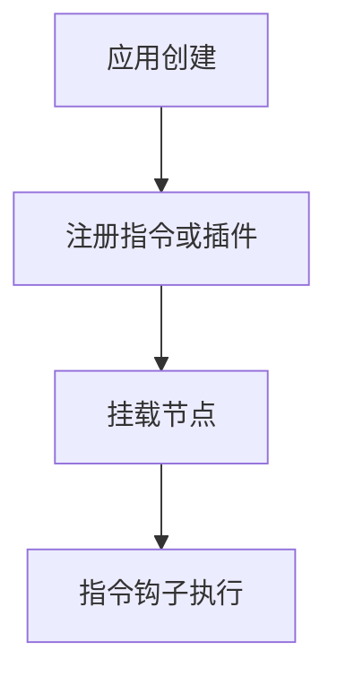

# 自定义指令与插件

> **当前主线**：用户指定的 Vue3＋TS 71 集课程；本篇为主题对照与自主讲解，旧 Vue2 演示保留为迁移参考。
> 示例版本：Vue 3.5.13；版本固定用于复现，不表示最新版本。

---

<span style="background-color:rgb(255, 249, 227)">一：学习目标与使用场景</span>

知道何时需要直接操作 DOM，以及指令、组件与插件各自负责什么。

---

<span style="background-color:rgb(255, 249, 227)">二：先把原理讲清楚</span>

组件负责可复用结构和行为，组合函数负责可复用状态逻辑，自定义指令适合复用底层 DOM 行为。例如自动聚焦、可见性观察或与某些原生事件交互。不要为了熟悉指令而重写已经可以用模板表达的数据绑定。

Vue 3 指令可在 mounted、updated、unmounted 等钩子中接收真实元素和绑定信息。binding.value 是当前值，oldValue 可用于比较。创建全局监听器或 Observer 后必须在合适钩子清理，避免元素消失后资源仍继续工作。

插件是应用级扩展入口，通常提供 install(app, options)，可以注册组件、指令或通过 provide 传递服务。Vue 3 用 app.use 安装到某个应用；Vue 2 的 Vue.use 使用全局构造器，两者作用范围不同。

指令钩子名称在 Vue 2 与 Vue 3 间发生变化。Vue 2 常见 inserted，对应 Vue 3 mounted 的使用场景；不能只升级运行库而忽略这些钩子。迁移时应逐个检查初始化、更新与清理时机，而不只是替换字符串。

---

<span style="background-color:rgb(255, 249, 227)">三：运行方式</span>

直接打开同目录下的 [配套演示](示例/21-自定义指令与插件.html)。运行库放在示例/vendor，已本地保存，普通示例不需要联网。Obsidian 的代码块用于阅读，不会自动执行 HTML。也可以把下面整段内容保存到示例目录中的新 HTML 文件；改变位置时需要相应调整运行库相对路径。

---

<span style="background-color:rgb(255, 249, 227)">四：完整代码演示</span>

```html
<!doctype html>
<html lang="zh-CN">
<head>
<meta charset="UTF-8">
<meta name="viewport" content="width=device-width, initial-scale=1">
<title>自定义指令与插件</title>
<style>
body{font-family:system-ui,sans-serif;line-height:1.7;margin:2rem auto;padding:0 1rem;max-width:58rem;color:#202124;background:#fff}button,input,select{font:inherit;padding:.4rem;margin:.3rem}button{cursor:pointer}label{display:inline-block;margin:.3rem}section{border:1px solid #aaa;padding:1rem;margin:1rem 0}li{margin:.4rem 0}pre{white-space:pre-wrap;overflow-wrap:anywhere}button:focus-visible,a:focus-visible,input:focus-visible,select:focus-visible{outline:3px solid #b45309}.active{background:#166534;color:#fff}nav{display:flex;gap:1rem;flex-wrap:wrap}
</style>
</head>
<body>
<div id="app">
<h1>自动聚焦指令</h1><label>打开页面即可输入 <input v-focus v-model="name"></label><p>输入：{{ name }}</p>
</div>
<script src="./vendor/vue-3.5.13.js"></script>
<script>
const {createApp, ref} = Vue;
const app = createApp({setup(){return {name:ref('')};}});
app.directive('focus', {
  mounted(el){el.focus();}
});
app.mount('#app');
</script>
</body>
</html>
```

---

<span style="background-color:rgb(255, 249, 227)">五：按执行顺序解释</span>

1. 创建 app 但先不挂载，为注册扩展留出机会。
2. directive 的名称写 focus，模板使用时加 v- 前缀。
3. mounted 中得到已经插入文档的 input，因此可以调用 focus。
4. 最后 mount 初始化组件和指令。

---

<span style="background-color:rgb(255, 249, 227)">六：预期结果与验证步骤</span>

页面打开时输入框自动获得焦点，输入内容同步显示在下方。

操作时同时打开浏览器开发者工具：Elements 查看模板生成的节点，Console 查看是否有语法错误或 Vue 警告。若页面显示双大括号原文，优先检查运行库路径、脚本加载顺序和挂载目标。

---

<span style="background-color:rgb(255, 249, 227)">七：图解</span>



---

<span style="background-color:rgb(255, 249, 227)">八：注意事项与易错点</span>

- 自动聚焦会移动用户焦点，应根据真实场景使用，不能给每个弹出的元素都强制抢焦点。
- 不要用指令随意修改 Vue 自己管理的复杂子树。
- 注册插件应在 mount 之前完成，避免部分实例无法获得所需服务。

---

<span style="background-color:rgb(255, 249, 227)">九：动手练习</span>

将 focus 指令封装成带 install 的插件。

<details>
<summary>参考答案与思路（先自己尝试）</summary>

```js
const FocusPlugin={install(app){app.directive('focus',{mounted(el){el.focus();}});}};
// app.use(FocusPlugin); app.mount('#app');
```

练习片段需要放入本篇已有的模板或 setup 对应位置，不是另一份独立文件。修改后重做上面的验证步骤，并检查空值、重复操作和恢复状态。

</details>

---

<span style="background-color:rgb(255, 249, 227)">十：复习问题</span>

1. 本篇中哪些数据是真正的源状态，哪些是推导结果或 DOM 表示？
2. 如果页面没有按预期更新，应该先检查运行环境、API 版本还是依赖关系？结合示例说明。
3. 能否不用背代码，用自己的话描述图中每一步的输入和输出？


---

<span style="background-color:rgb(255, 249, 227)">十一：相关笔记</span>

[[前端/VUE/20-动态组件KeepAlive与Transition|上一篇：动态组件、KeepAlive 与 Transition]] · [[前端/VUE/22-综合练习待办清单|下一篇：综合练习：待办清单]] · [[前端/VUE/00-Vue学习索引]]

---

<span style="background-color:rgb(255, 249, 227)">十二：官方参考与来源边界</span>

- [Vue 3 中文指南](https://cn.vuejs.org/guide/introduction.html)
- [Vue 2 中文指南](https://v2.cn.vuejs.org/v2/guide/)
- [Vue 2 维护结束说明](https://v2.vuejs.org/eol/)

原有示例和参考继续保留；当前课程目录已另行核验。没有取得字幕，不将自主讲解声称为视频逐字内容。

---

<span style="background-color:rgb(255, 249, 227)">专题深化：指令处理 DOM，插件组织应用能力</span>

组件通常组织界面与业务逻辑，自定义指令适合确需接触底层 DOM 的可复用行为，如聚焦或外部事件绑定；插件通过 app.use 安装应用范围能力。二者不是给所有工具函数“换个高级写法”。

指令绑定了监听、观察器或第三方实例，就需要在相应卸载钩子清理。安装插件时明确影响当前 app，不把 Vue2 构造函数上的全局写法直接照搬到 Vue3。

优先问现有模板绑定与组件是否足够；只有 DOM 级复用需求明确时才上指令，以免业务规则散落到难以测试的钩子里。

- [指定课程 P70](https://www.bilibili.com/video/BV1Za4y1r7KE/?p=70)
- [[前端/VUE/00-课程目录与来源说明|已核验的完整分集目录与来源边界]]
- [Vue 官方指南](https://vuejs.org/guide/introduction.html)
- [Vue 与 TypeScript](https://vuejs.org/guide/typescript/composition-api.html)
