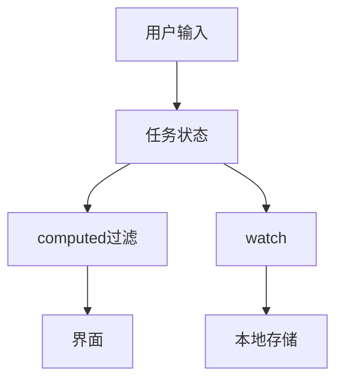

# 综合练习：待办清单

> 课程范围：P117 至最后（用户指定）。未取得视频逐集标题与字幕，本篇为自主编写的知识体系笔记，不代表逐集内容已核验。
> 示例版本：Vue 3.5.13；版本固定用于复现，不表示最新版本。

## 学习目标与使用场景

把输入、事件、列表、计算属性与本地存储连成一个可使用的小应用。

## 先把原理讲清楚

单个 API 会用不等于能够组合完成需求。本练习把状态分为任务数组、输入草稿和过滤条件；任务的可见列表和剩余数量由 computed 推导。这样的划分能避免维护重复的“总数状态”或“过滤后数组状态”。

每个任务有稳定 id、文字 title 和完成标记 done。添加与删除按 ID 操作，模板只负责展示结果。给空输入阻止添加、为按钮提供明确文字、为输入提供 label，都是完整交互的一部分，不是最后再补的装饰。

保存使用 localStorage，需要考虑读取失败、JSON 损坏、结构不符合预期和写入配额异常。示例只存非敏感任务数据，读取时检查字段类型，失败时给出提示并回退到空列表。离线持久化不是云同步，换浏览器或清除网站数据后不会自动恢复。

watch 监听任务数组的深层变化，完成切换、添加和删除后保存。小规模练习这样容易理解；大型列表应评估遍历和同步写入成本，必要时防抖或采用更合适的存储方案。不要因为演示能存几条就推断它能承载任意数据量。

## 运行方式

直接打开同目录下的 [配套演示](示例/22-综合练习待办清单.html)。运行库放在示例/vendor，已本地保存，普通示例不需要联网。Obsidian 的代码块用于阅读，不会自动执行 HTML。也可以把下面整段内容保存到示例目录中的新 HTML 文件；改变位置时需要相应调整运行库相对路径。

## 完整代码演示

```html
<!doctype html>
<html lang="zh-CN">
<head>
<meta charset="UTF-8">
<meta name="viewport" content="width=device-width, initial-scale=1">
<title>综合练习：待办清单</title>
<style>
body{font-family:system-ui,sans-serif;line-height:1.7;margin:2rem auto;padding:0 1rem;max-width:58rem;color:#202124;background:#fff}button,input,select{font:inherit;padding:.4rem;margin:.3rem}button{cursor:pointer}label{display:inline-block;margin:.3rem}section{border:1px solid #aaa;padding:1rem;margin:1rem 0}li{margin:.4rem 0}pre{white-space:pre-wrap;overflow-wrap:anywhere}button:focus-visible,a:focus-visible,input:focus-visible,select:focus-visible{outline:3px solid #b45309}.active{background:#166534;color:#fff}nav{display:flex;gap:1rem;flex-wrap:wrap}
</style>
</head>
<body>
<div id="app">
<h1>学习待办</h1><form @submit.prevent="add"><label>新任务 <input v-model.trim="draft" maxlength="80"></label><button>添加</button></form><label>筛选 <select v-model="filter"><option value="all">全部</option><option value="open">未完成</option></select></label><p>剩余 {{ remaining }} 项</p><p role="status">{{ notice }}</p><ul><li v-for="task in visible" :key="task.id"><label><input type="checkbox" v-model="task.done">{{ task.title }}</label><button @click="remove(task.id)">删除</button></li></ul><p v-if="visible.length === 0">当前没有任务</p>
</div>
<script src="./vendor/vue-3.5.13.js"></script>
<script>
const {createApp, ref, computed, watch} = Vue;
createApp({setup(){
  const key='frontend-vue-todos-v1'; const notice=ref(''); let initial=[];
  try {
    const parsed=JSON.parse(localStorage.getItem(key) || '[]');
    if(Array.isArray(parsed)) initial=parsed.filter(x => x && typeof x.id==='string' && typeof x.title==='string' && typeof x.done==='boolean');
  } catch(e){notice.value='本地数据读取失败，使用空列表';}
  const tasks=ref(initial), draft=ref(''), filter=ref('all');
  const remaining=computed(() => tasks.value.filter(x=>!x.done).length);
  const visible=computed(() => filter.value==='open' ? tasks.value.filter(x=>!x.done) : tasks.value);
  function add(){
    if(!draft.value) {notice.value='请先输入任务';return;}
    tasks.value.push({id:Date.now().toString(36)+'-'+Math.random().toString(36).slice(2),title:draft.value,done:false});
    draft.value=''; notice.value='已添加';
  }
  function remove(id){tasks.value=tasks.value.filter(x=>x.id!==id);}
  watch(tasks,()=>{try{localStorage.setItem(key,JSON.stringify(tasks.value));}catch(e){notice.value='保存失败，当前任务仍可使用';}},{deep:true});
  return {tasks,draft,filter,remaining,visible,notice,add,remove};
}}).mount('#app');
</script>
</body>
</html>
```

## 按执行顺序解释

1. 读取存储时用 try/catch，检查数组和每项字段，避免坏数据直接进入模板。
2. visible 和 remaining 都由 tasks 计算，不需要单独手动同步。
3. ID 在添加时生成一次，渲染时不重新生成；这里只是本地练习 ID，真实项目可用服务端 ID。
4. watch deep 捕获 done 的变化，并在写入失败时保持页面可操作。

## 预期结果与验证步骤

可以添加、勾选、筛选、删除任务；支持存储的浏览器中刷新后仍保留。若本地 file URL 存储被浏览器限制，会显示读写提示。

操作时同时打开浏览器开发者工具：Elements 查看模板生成的节点，Console 查看是否有语法错误或 Vue 警告。若页面显示双大括号原文，优先检查运行库路径、脚本加载顺序和挂载目标。

## 图解



## 注意事项与易错点

- localStorage 在 file URL 上的行为取决于浏览器，稳定测试应使用同一 HTTP 来源。
- 本地任务没有用户鉴权与云备份，不存密码或其他敏感信息。
- 如果外部篡改存储造成重复 ID，生产实现还应去重；示例重点是数据流和异常降级。

## 动手练习

增加“清除已完成”按钮，并验证未完成任务不受影响。

<details>
<summary>参考答案与思路（先自己尝试）</summary>

```js
function clearDone(){tasks.value=tasks.value.filter(task=>!task.done);}
// setup 返回 clearDone，模板增加 <button @click="clearDone">清除已完成</button>
```

练习片段需要放入本篇已有的模板或 setup 对应位置，不是另一份独立文件。修改后重做上面的验证步骤，并检查空值、重复操作和恢复状态。

</details>

## 复习问题

1. 本篇中哪些数据是真正的源状态，哪些是推导结果或 DOM 表示？
2. 如果页面没有按预期更新，应该先检查运行环境、API 版本还是依赖关系？结合示例说明。
3. 能否不用背代码，用自己的话描述图中每一步的输入和输出？


## 相关笔记

[[前端/VUE/21-自定义指令与插件|上一篇：自定义指令与插件]] · [[前端/VUE/23-Vue2到Vue3语法对照|下一篇：Vue 2 到 Vue 3 语法对照]] · [[前端/VUE/00-Vue学习索引]]

## 官方参考与来源边界

- [Vue 3 中文指南](https://cn.vuejs.org/guide/introduction.html)
- [Vue 2 中文指南](https://v2.cn.vuejs.org/v2/guide/)
- [Vue 2 维护结束说明](https://v2.vuejs.org/eol/)

以上文档用于核对 API 和版本差异；课程链接与集数只来自用户指定范围，未据此编造每集标题或台词。
