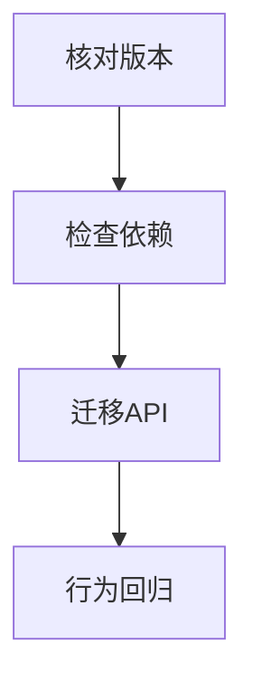

# Vue 2 到 Vue 3 语法对照

> **当前主线**：用户指定的 Vue3＋TS 71 集课程；本篇为主题对照与自主讲解，旧 Vue2 演示保留为迁移参考。
> 示例版本：Vue 3.5.13；版本固定用于复现，不表示最新版本。

---

<span style="background-color:rgb(255, 249, 227)">一：学习目标与使用场景</span>

看旧课程时能识别版本边界，避免把两套 API 机械拼接。

---

<span style="background-color:rgb(255, 249, 227)">二：先把原理讲清楚</span>

Vue 2 与 Vue 3 的模板基础相似：插值、属性绑定、事件、条件和列表大多可以延续。差异集中在初始化、响应式边界、组件 v-model、生命周期、插件和一些已移除语法。迁移时按功能验证比全局替换文本可靠。

Vue 2 常见 new Vue({el:'#app'})，Vue 3 为 createApp(App).mount('#app')。Vue 3 的应用级组件、指令和插件注册一般通过 app 完成，多个应用互不依赖同一个全局构造器。这也是为什么 Vue.use 不能直接照搬成 Vue 3 的初始化步骤。

Options API 在 Vue 3 中继续可用，因此可以先迁移版本，再逐步按需求整理到 Composition API。一次性同时改语法风格、路由、状态管理和构建系统，会让错误难以定位。先让行为保持一致，再做结构优化更稳妥。

课程后半部分到底使用哪个版本，需要通过 package.json、Vue.version、new Vue/createApp 等证据核对。本知识库尚未拿到视频字幕与分集标题，所以以下是官方 API 对照，不是对课程每一集的断言。新项目和遗留项目需要采用不同策略，Vue 2 已结束官方维护这一事实也应纳入选择。

---

<span style="background-color:rgb(255, 249, 227)">三：运行方式</span>

直接打开同目录下的 [配套演示](示例/23-Vue2到Vue3语法对照.html)。运行库放在示例/vendor，已本地保存，普通示例不需要联网。Obsidian 的代码块用于阅读，不会自动执行 HTML。也可以把下面整段内容保存到示例目录中的新 HTML 文件；改变位置时需要相应调整运行库相对路径。

---

<span style="background-color:rgb(255, 249, 227)">四：完整代码演示</span>

```html
<!doctype html>
<html lang="zh-CN">
<head>
<meta charset="UTF-8">
<meta name="viewport" content="width=device-width, initial-scale=1">
<title>Vue 2 到 Vue 3 语法对照</title>
<style>
body{font-family:system-ui,sans-serif;line-height:1.7;margin:2rem auto;padding:0 1rem;max-width:58rem;color:#202124;background:#fff}button,input,select{font:inherit;padding:.4rem;margin:.3rem}button{cursor:pointer}label{display:inline-block;margin:.3rem}section{border:1px solid #aaa;padding:1rem;margin:1rem 0}li{margin:.4rem 0}pre{white-space:pre-wrap;overflow-wrap:anywhere}button:focus-visible,a:focus-visible,input:focus-visible,select:focus-visible{outline:3px solid #b45309}.active{background:#166534;color:#fff}nav{display:flex;gap:1rem;flex-wrap:wrap}
</style>
</head>
<body>
<div id="app">
<h1>版本检查</h1><p>当前演示运行库：{{ version }}</p><p>组织风格：Options API，运行版本：Vue 3</p><button @click="count++">{{ count }}</button>
</div>
<script src="./vendor/vue-3.5.13.js"></script>
<script>
Vue.createApp({
  data(){return {version:Vue.version,count:0};},
  methods:{reset(){this.count=0;}}
}).mount('#app');
</script>
</body>
</html>
```

---

<span style="background-color:rgb(255, 249, 227)">五：按执行顺序解释</span>

1. 直接查看 Vue.version 能明确运行库版本，比根据个人代码风格猜测更可靠。
2. 此例使用 data 和 methods，但初始化是 createApp，因此仍是 Vue 3。
3. 模板中 count++ 的基本写法在两代版本都能理解。
4. 迁移时先列出外部依赖，再检查移除特性和行为差异，最后执行交互回归。

---

<span style="background-color:rgb(255, 249, 227)">六：预期结果与验证步骤</span>

页面显示本地固定的 Vue 3.5.13 版本号，按钮可递增；Options API 仍正常工作。

操作时同时打开浏览器开发者工具：Elements 查看模板生成的节点，Console 查看是否有语法错误或 Vue 警告。若页面显示双大括号原文，优先检查运行库路径、脚本加载顺序和挂载目标。

---

<span style="background-color:rgb(255, 249, 227)">七：图解</span>



---

<span style="background-color:rgb(255, 249, 227)">八：注意事项与易错点</span>

- Vue 3 移除过滤器 filters，常用 computed 或方法替代。
- Vue 3 不再支持实例 $on/$off/$once 作为事件总线；组件 $emit 仍然存在。
- Vue 2 数组或对象新增的限制与 Vue 3 不同；v-if/v-for 优先级也变化，避免同节点混用。

---

<span style="background-color:rgb(255, 249, 227)">九：动手练习</span>

把一个 Vue 2 根实例的初始化改成 Vue 3，同时保留 Options API。

<details>
<summary>参考答案与思路（先自己尝试）</summary>

```js
// Vue 2: new Vue({el:'#app',data(){return {count:0};}})
// Vue 3:
Vue.createApp({data(){return {count:0};}}).mount('#app');
```

练习片段需要放入本篇已有的模板或 setup 对应位置，不是另一份独立文件。修改后重做上面的验证步骤，并检查空值、重复操作和恢复状态。

</details>

---

<span style="background-color:rgb(255, 249, 227)">十：复习问题</span>

1. 本篇中哪些数据是真正的源状态，哪些是推导结果或 DOM 表示？
2. 如果页面没有按预期更新，应该先检查运行环境、API 版本还是依赖关系？结合示例说明。
3. 能否不用背代码，用自己的话描述图中每一步的输入和输出？

---

<span style="background-color:rgb(255, 249, 227)">十一：常用对照表</span>

| 用途 | Vue 2 | Vue 3 |
| --- | --- | --- |
| 初始化 | new Vue | createApp |
| 卸载钩子 | beforeDestroy / destroyed | beforeUnmount / unmounted |
| 组件默认 v-model | value / input | modelValue / update:modelValue |
| 新增响应式字段 | Vue.set / $set | 代理支持常规新增，不使用 $set |
| 插件 | Vue.use | app.use |
| 路由对应版本 | Router 3 | Router 4 |
| 过滤器 | filters | 改用 computed 或方法 |

Vue 2.7 的组合式 API 不代表其底层响应式实现已经变为 Vue 3。

---

<span style="background-color:rgb(255, 249, 227)">十二：相关笔记</span>

[[前端/VUE/22-综合练习待办清单|上一篇：综合练习：待办清单]] · [[前端/VUE/00-Vue学习索引|回到目录]] · [[前端/VUE/00-Vue学习索引]]

---

<span style="background-color:rgb(255, 249, 227)">十三：官方参考与来源边界</span>

- [Vue 3 中文指南](https://cn.vuejs.org/guide/introduction.html)
- [Vue 2 中文指南](https://v2.cn.vuejs.org/v2/guide/)
- [Vue 2 维护结束说明](https://v2.vuejs.org/eol/)

原有示例和参考继续保留；当前课程目录已另行核验。没有取得字幕，不将自主讲解声称为视频逐字内容。

---

<span style="background-color:rgb(255, 249, 227)">专题深化：迁移先定位机制变化再改语法</span>

迁移不只是把 `new Vue` 换成 createApp。组件 v-model 协议、全局 API、事件 API、生命周期命名、响应式限制与周边依赖都可能受影响。先列出项目实际使用的功能，逐项确认替代关系。

保留已有行为测试与小型交互样例，比一次性重写所有页面可靠。Options API 在 Vue3 仍可使用，Composition API 是组织逻辑的新选择，不应误说“Vue3 只能 setup”。

组件库、路由与状态库也要版本配套。运行 Vue3 时使用 VueRouter4；此目录旧演示库固定保存用于复现，新工程锁文件另外管理。

- [指定课程 P6、P27—P28、P70—P71](https://www.bilibili.com/video/BV1Za4y1r7KE/?p=6)
- [[前端/VUE/00-课程目录与来源说明|已核验的完整分集目录与来源边界]]
- [Vue 官方指南](https://vuejs.org/guide/introduction.html)
- [Vue 与 TypeScript](https://vuejs.org/guide/typescript/composition-api.html)
